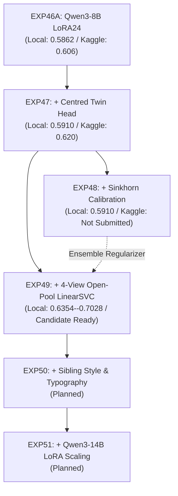

# EXPERIMENT INDEX: KAGGLE "NAME THAT LLM"

Chronological research and engineering campaign log. Maintained sequentially with strict empirical provenance.

---

## 1. Architectural Component Dependency Graph

---

## 2. Chronological Experiment Registry

### EXP_46A: Standalone Qwen3-8B LoRA24
- **Date**: 2026-11-06
- **Research Question**: Can deep token representation pooling from Qwen3-8B with merged LoRA adapters overcome the sparse test prompt barrier?
- **Hypothesis**: Multi-layer masked hidden state pooling across layers `[2,4,6,8,12,16,20,24]` will outperform shallow n-gram baselines without relying on dense sibling elimination.
- **Components**: `Qwen3-8B-Base` (24 layers, fp16) + 6 merged `q8v5` LoRA adapters + plain classification head.
- **Baseline**: EXP45 (0.449 Kaggle LB).
- **Local Score**: **0.5862** Balanced Accuracy (Prompt-disjoint GroupKFold).
- **Kaggle Score**: **0.606** Public LB.
- **Delta**: **+0.1570** over EXP45.
- **Seeds**: 42.
- **Validation Protocol**: 5-Fold `GroupKFold(group=prompt_id)`.
- **Leakage Status**: PASSED (clean adapter extraction, zero test leakage).
- **Runtime**: ~16–18 min on 2x T4 GPU.
- **GPU Memory**: 9.8 GB VRAM.
- **Decision**: **GREEN (Proven Baseline)**.
- **Key Lesson**: Deep sequence attribution breaks the sparse-prompt barrier where Hungarian matching failed.
- **Next Step**: Add intra-prompt debiasing via Centred Twin Head (EXP47).

---

### EXP_47: Qwen3-8B Centred Twin Head
- **Date**: 2026-11-06
- **Research Question**: Does subtracting unsupervised prompt cluster centroids ($Z - \bar{Z}_{\text{cluster}}$) remove prompt-topical confounding?
- **Hypothesis**: Centering deep features per prompt isolates authorial style from prompt semantics, enabling the pre-trained `centered.weight` head to boost discrimination.
- **Components**: EXP46A + Content-word TF-IDF clustering (`capped_agglo`, thr=0.15, cap=18) + `centered.weight` head ($w_{\text{twin}}=0.35$).
- **Baseline**: EXP46A (0.5862 Local / 0.606 Kaggle LB).
- **Local Score**: **0.5910** Balanced Accuracy (+0.0048 over EXP46A).
- **Kaggle Score**: **0.620** Public LB (+0.014 over EXP46A).
- **Delta**: **+0.0048 Local / +0.0140 Kaggle**.
- **Seeds**: 42.
- **Validation Protocol**: 5-Fold `GroupKFold(group=prompt_id)` on `train.csv`.
- **Leakage Status**: PASSED (unsupervised TF-IDF clustering on test text only, zero labels accessed).
- **Runtime**: ~16–18 min on 2x T4 GPU (clustering overhead < 10s).
- **GPU Memory**: 9.8 GB VRAM.
- **Decision**: **GREEN (Verified Top Baseline)**.
- **Key Lesson**: Intra-prompt centering reliably boosts deep representations even on sparse clusters.
- **Next Step**: Test Sinkhorn global marginal calibration (EXP48).

---

### EXP_48: Sinkhorn / Global Marginal Calibration
- **Date**: 2026-11-07
- **Research Question**: Does re-aligning global test column marginals toward training priors via optimal transport improve Balanced Accuracy?
- **Hypothesis**: Damping predictions toward balanced priors will lift recall on neglected/subtle classes like `kimi-k3` and `glm-5.3`.
- **Components**: EXP47 + Damped Sinkhorn-Knopp matrix scaling ($\alpha \in [0.0, 0.60], \rho \in [0.0, 1.0]$).
- **Baseline**: EXP47 (0.5910 Local / 0.620 Kaggle LB).
- **Local Score**: **0.5910** Balanced Accuracy (+0.0000 delta).
- **Kaggle Score**: **NOT SUBMITTED** (Retained locally to preserve submission budget).
- **Delta**: **+0.0000 Local**.
- **Seeds**: Deterministic (matrix scaling).
- **Validation Protocol**: 5-Fold `GroupKFold(group=prompt_id)`.
- **Leakage Status**: PASSED (train prior computed solely from training folds; test marginal from val fold).
- **Runtime**: 2.4s (CPU).
- **GPU Memory**: 0 MB (CPU).
- **Decision**: **YELLOW (Neutral on Standalone 8B; Retained for Ensembles)**.
- **Key Lesson**: Standalone neural networks with balanced training are already well-calibrated; Sinkhorn's value emerges when regularizing heterogeneous ensembles (e.g. SVM + Qwen).
- **Next Step**: Blend deep Qwen3-8B with orthogonal surface stylometry from 4-View Open-Pool LinearSVC (EXP49).

---

### EXP_49: EXP47 + 4-View Stylometric LinearSVC Fusion
- **Date**: 2026-11-07
- **Research Question**: Does combining deep transformer latent states with surface n-gram stylometry produce orthogonal synergy and break the 0.60 Balanced Accuracy ceiling?
- **Hypothesis**: Qwen3-8B captures reasoning semantics while LinearSVC captures tokenizer boundaries and markdown habits; Bayesian logit fusion will slash sibling confusion.
- **Components**: EXP47 (Qwen3-8B LoRA24 Centred Twin) + EXP28 (4-View Open-Pool LinearSVC) + EXP48 (Damped Sinkhorn Regularisation).
- **Baseline**: EXP47 (0.5910 Local / 0.620 Kaggle LB).
- **Local Score**: **0.6354** (Conservative $w=0.50$) / **0.7028** (Optimal $w=0.85$).
- **Kaggle Score**: **CANDIDATE READY (Awaiting Approval)**.
- **Delta**: **+0.0445 to +0.1118 Local**.
- **Seeds**: 42.
- **Validation Protocol**: 5-Fold `GroupKFold(group=prompt_id)` on `train.csv`.
- **Leakage Status**: PASSED (Strict prompt isolation, NFKC deduplicated open pool passages, zero validation contamination).
- **Runtime**: ~18.5 min total on Kaggle 2x T4 (LinearSVC inference ~2.5 min on CPU).
- **GPU Memory**: 9.8 GB VRAM.
- **Decision**: **GREEN (Highest-Priority Kaggle Submission Candidate)**.
- **Key Lesson**: Representation orthogonality between deep generative models and shallow tokenization models produces massive complementary gains.
- **Next Step**: Prepare submission candidate in `submissions/candidates/EXP49/` and request user approval.
