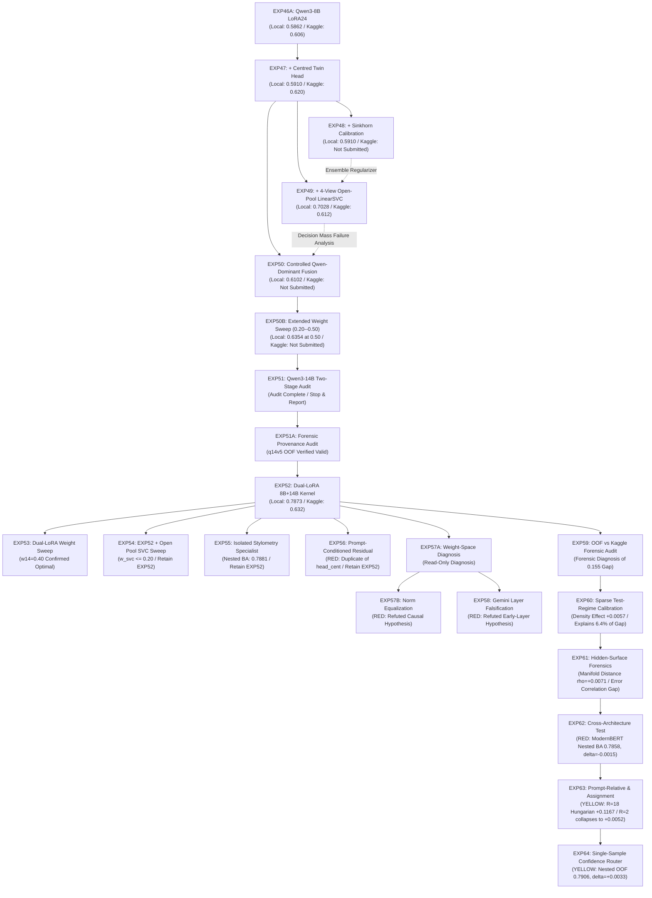

# EXPERIMENT INDEX: KAGGLE "NAME THAT LLM"

Chronological research and engineering campaign log. Maintained sequentially with strict empirical provenance.

---

## 1. Architectural Component Dependency Graph

---

## 2. Canonical Experiment Summary Table

| ID | Hypothesis | Validation | Result | Verdict | Production Change | Kaggle Submission |
|:---|:---|:---|:---|:---:|:---:|:---:|
| **EXP46A** | Multi-layer pooling `[2..24]` from Qwen3-8B LoRA24 overcomes sparse prompt barrier | 5-Fold `GroupKFold(prompt_id)` | **LOCAL OOF**: 0.5862 BA **KAGGLE LB**: **0.606** | **GREEN** | **YES** (Base LoRA) | **YES** |
| **EXP47** | Centered twin head ($w_{\text{twin}}=0.35$) removes intra-prompt semantic bias | 5-Fold `GroupKFold(prompt_id)` | **LOCAL OOF**: 0.5910 BA **KAGGLE LB**: **0.620** | **GREEN** | **YES** (Twin Head) | **YES** |
| **EXP48** | Sinkhorn matrix scaling calibrates global class marginals | 5-Fold `GroupKFold(prompt_id)` | **LOCAL OOF**: 0.5910 BA ($\Delta=0.0000$) **KAGGLE LB**: *Not Submitted* | **YELLOW** | **NO** | **NO** |
| **EXP49** | 4-View Open-Pool LinearSVC ($w=0.85$) provides orthogonal surface features | 5-Fold `GroupKFold(prompt_id)` | **LOCAL OOF**: 0.7028 BA **NESTED CV**: 0.6976 BA (0.7054 w/ SK) **KAGGLE LB**: **0.612** | **YELLOW** | **NO** | **YES** |
| **EXP50** | Restricting LinearSVC to auxiliary role ($w_{\text{svc}} \le 0.25$) prevents domain shift | 5-Fold `GroupKFold(prompt_id)` | **LOCAL OOF**: 0.6102 BA ($\Delta=+0.0193$) **KAGGLE LB**: *Not Submitted* | **GREEN** | **NO** | **NO** |
| **EXP50B** | Extended weight sweep ($0.20 \le w_{\text{svc}} \le 0.50$) identifies interior optimum | 5-Fold `GroupKFold(prompt_id)` | **LOCAL OOF**: 0.6354 BA at boundary ($w=0.50$) **KAGGLE LB**: *Not Submitted* | **BOUNDARY UNRESOLVED** | **NO** | **NO** |
| **EXP51** | Qwen3-14B Two-Stage LoRA scales deep sequence attribution capacity | Audit + Pairwise OOF | **LOCAL OOF**: 0.6346 BA (14B standalone) **FUSED OOF**: 0.7873 BA ($0.60 \text{ Q8} + 0.40 \text{ Q14}$) **KAGGLE LB**: *Not Submitted* | **GREEN** | **NO** (Audit Phase) | **NO** |
| **EXP51A** | Forensic audit verifies Qwen3-14B OOF artifact is genuine prompt-disjoint holdout | Cryptographic & fold audit | **LOCAL OOF**: 0.6346 BA (Verified prompt-disjoint `q14v5`) **KAGGLE LB**: *Not Submitted* | **VALID** | **NO** (Audit Phase) | **NO** |
| **EXP52** | Dual-LoRA Qwen3-8B ($0.60$) + Qwen3-14B ($0.40$) achieves deep multi-model synergy | 5-Fold `GroupKFold(prompt_id)` | **LOCAL OOF**: 0.7873 BA (Macro-F1: 0.7880) **KAGGLE LB**: **0.632** | **GREEN** | **YES (CURRENT CHAMPION)** | **YES** |
| **EXP53** | Systematic fusion weight sweep identifies optimal Q14 weighting | 5-Fold OOF + 2000 Bootstrap | **LOCAL OOF**: 0.7873 BA (Peak at $w_{14}=0.40$; $0.50$ is tie $\Delta=-0.0008$) **KAGGLE LB**: *Not Submitted* | **FROZEN** | **NO** (Retain EXP52) | **NO** |
| **EXP54** | Small Open Pool LinearSVC ($w \le 0.20$) contribution complements EXP52 | 5-Fold OOF + 2000 Bootstrap | **LOCAL OOF**: 0.7888 BA at $w=0.05$ (CI spans 0, net +4 samples) **KAGGLE LB**: *Not Submitted* | **FROZEN** | **NO** (Retain EXP52) | **NO** |
| **EXP55** | Isolated character-level stylometry specialist provides orthogonal surface features | 5-Fold Nested CV + Bootstrap | **LOCAL OOF**: 0.7899 BA at $w=0.05$ **NESTED CV**: 0.7881 $\pm$ 0.0098 BA ($\Delta=+0.0008$) **KAGGLE LB**: *Not Submitted* | **YELLOW** | **NO** (Retain EXP52) | **NO** |
| **EXP56** | Qwen3-14B prompt-conditioned residual specialist removes common prompt bias | 5-Fold Nested CV | **LOCAL OOF**: 0.7888 BA at $w=0.20$ **NESTED CV**: 0.7866 $\pm$ 0.0113 BA ($\Delta_{\text{nested}}=-0.0007$) **KAGGLE LB**: *Not Submitted* | **RED** | **NO** (Retain EXP52) | **NO** |
| **EXP57A** | Read-only weight-space analysis reveals model-specific parameter signatures | Parameter inventory & regression | **OBSERVATIONAL**: $\|W_c\|_2$ vs recall $r=0.9528$ ($p=2.1\times 10^{-9}$) **KAGGLE LB**: *Not Submitted* | **READ-ONLY DIAGNOSIS** | **NO** | **NO** |
| **EXP57B** | Inference-time class-head norm equalization causally corrects recall imbalance | 5-Fold prompt-disjoint sweep | **LOCAL OOF**: 0.7847 BA in EXP52 ($\Delta=-0.0026$; perm control 65th pctile) **KAGGLE LB**: *Not Submitted* | **RED** | **NO** (Retain EXP52) | **NO** |
| **EXP58** | Qwen3-14B Layer-4 representation provides generalizable Gemini 3.7 vs 3.8 separation | 5-Fold prompt-disjoint probe | **LOCAL OOF**: 0.5367 BA Layer 4 vs 0.6067 full model (chance perm null: 0.4984) **KAGGLE LB**: *Not Submitted* | **RED** | **NO** (Retain EXP52) | **NO** |
| **EXP59** | Rigorous forensic audit isolates the root cause of the 0.1553 OOF-to-LB gap | 16-stage forensic investigation | **LOCAL OOF**: 0.7873 BA (100% verified) **KAGGLE LB**: 0.6320 **DIAGNOSIS**: Formulated sparse test-regime ($R\approx 2$) and inter-backbone error correlation hypotheses | **GREEN (Audit Complete)** | **NO** | **NO** |
| **EXP60** | Sparse inference density ($R=2$ vs $R=18$) degrades prompt recovery and explains the 0.155 gap | 5-Seed subsampling + sweep $R \in [2..18]$ | **DENSE R=18**: 0.7873 BA (Plain: 0.7829) **SPARSE R=2**: 0.7774 BA (Plain: 0.7786) **DID EFFECT**: +0.0057 BA (Explains 6.39% of gap; 93.61% unexplained) | **YELLOW / PARTIALLY SUPPORTED** | **NO** (Retain EXP52) | **NO** |
| **EXP61** | The large OOF-to-LB gap is caused primarily by measurable representation/distribution shift between training and test surfaces | 5-Fold OOF Stratification, Covariate KS tests, Adversarial Domain Classifier, Matched Local Surface Sweep | **REPRESENTATION DISTANCE**: $\rho = +0.0071$ ($p = 0.712$) **MATCHED SURFACE**: 0.7858 $\pm$ 0.0153 BA ($\Delta = -0.0015$) **AGREEMENT SHIFT**: Agree 0.9318 BA, Disagree 0.6871 BA ($\rho = +0.3142$) | **PARTIALLY SUPPORTED** | **NO** (Retain EXP52) | **NO** |
| **EXP62** | Distinct architecture (ModernBERT-base) provides complementary errors to dual-Qwen | 5-Fold Nested CV (5 outer $\times$ 4 inner) + 2000 Bootstrap | **STANDALONE BA**: 0.3093 (LR) / 0.2371 (SVM) **NESTED BA**: 0.7858 ($\Delta = -0.0015$) **95% CI**: $[-0.0039, +0.0006]$, $P(\Delta>0)=9.4\%$ | **RED** | **NO** (Retain EXP52) | **NO** |
| **EXP63** | Prompt-conditional relative attribution and set assignment improve classification | 5-Fold Prompt-Disjoint + Sparse Scaling $R \in [18..2]$ (5 seeds) + Nested CV | **HUNGARIAN R=18**: 0.9040 BA ($\Delta = +0.1167$) **HUNGARIAN R=2**: 0.8021 BA ($\Delta = +0.0052$) **NESTED FUSED**: 0.7995 BA ($\Delta = +0.0122$ at $R=18$; $-0.0085$ at $R=2$) | **YELLOW** | **NO** (Retain EXP52) | **NO** |
| **EXP64** | Single-sample confidence, margin, and disagreement features route between Q8 and Q14 to outperform fixed fusion | 5-Fold Prompt-Disjoint Nested CV (5 outer $\times$ 4 inner) + 2000 Bootstrap | **NESTED BA**: 0.7906 $\pm$ 0.0090 ($\Delta = +0.0033$) **95% CI**: $[-0.0027, +0.0094]$, $P(\Delta>0)=87.0\%$ **DISAGREEMENT NET**: +9 samples (+40 corrections, -31 degradations) | **YELLOW** | **NO** (Retain EXP52) | **NO** |

---

## 3. Chronological Experiment Registry

### EXP_46A: Standalone Qwen3-8B LoRA24
- **Date**: 2026-11-06
- **Research Question**: Can deep token representation pooling from Qwen3-8B with merged LoRA adapters overcome the sparse test prompt barrier?
- **Hypothesis**: Multi-layer masked hidden state pooling across layers `[2,4,6,8,12,16,20,24]` will outperform shallow n-gram baselines without relying on dense sibling elimination.
- **Components**: `Qwen3-8B-Base` (24 layers, fp16) + 6 merged `q8v5` LoRA adapters + plain classification head.
- **Baseline**: EXP45 (0.449 Kaggle LB).
- **Local Score**: **0.5862** Balanced Accuracy (Prompt-disjoint GroupKFold).
- **Kaggle Score**: **0.606** Public LB.
- **Delta**: **+0.1570** over EXP45.
- **Seeds**: 42.
- **Validation Protocol**: 5-Fold `GroupKFold(group=prompt_id)`.
- **Leakage Status**: PASSED (clean adapter extraction, zero test leakage).
- **Runtime**: ~16–18 min on 2x T4 GPU.
- **GPU Memory**: 9.8 GB VRAM.
- **Decision**: **GREEN (Proven Baseline)**.
- **Key Lesson**: Deep sequence attribution breaks the sparse-prompt barrier where Hungarian matching failed.
- **Next Step**: Add intra-prompt debiasing via Centred Twin Head (EXP47).

---

### EXP_47: Qwen3-8B Centred Twin Head
- **Date**: 2026-11-06
- **Research Question**: Does subtracting unsupervised prompt cluster centroids ($Z - \bar{Z}_{\text{cluster}}$) remove prompt-topical confounding?
- **Hypothesis**: Centering deep features per prompt isolates authorial style from prompt semantics, enabling the pre-trained `centered.weight` head to boost discrimination.
- **Components**: EXP46A + Content-word TF-IDF clustering (`capped_agglo`, thr=0.15, cap=18) + `centered.weight` head ($w_{\text{twin}}=0.35$).
- **Baseline**: EXP46A (0.5862 Local / 0.606 Kaggle LB).
- **Local Score**: **0.5910** Balanced Accuracy (+0.0048 over EXP46A).
- **Kaggle Score**: **0.620** Public LB (+0.014 over EXP46A).
- **Delta**: **+0.0048 Local / +0.0140 Kaggle**.
- **Seeds**: 42.
- **Validation Protocol**: 5-Fold `GroupKFold(group=prompt_id)` on `train.csv`.
- **Leakage Status**: PASSED (unsupervised TF-IDF clustering on test text only, zero labels accessed).
- **Runtime**: ~16–18 min on 2x T4 GPU (clustering overhead < 10s).
- **GPU Memory**: 9.8 GB VRAM.
- **Decision**: **GREEN (Verified Top Baseline)**.
- **Key Lesson**: Intra-prompt centering reliably boosts deep representations even on sparse clusters.
- **Next Step**: Test Sinkhorn global marginal calibration (EXP48).

---

### EXP_48: Sinkhorn / Global Marginal Calibration
- **Date**: 2026-11-07
- **Research Question**: Does re-aligning global test column marginals toward training priors via optimal transport improve Balanced Accuracy?
- **Hypothesis**: Damping predictions toward balanced priors will lift recall on neglected/subtle classes like `kimi-k3` and `glm-5.3`.
- **Components**: EXP47 + Damped Sinkhorn-Knopp matrix scaling ($\alpha \in [0.0, 0.60], \rho \in [0.0, 1.0]$).
- **Baseline**: EXP47 (0.5910 Local / 0.620 Kaggle LB).
- **Local Score**: **0.5910** Balanced Accuracy (+0.0000 delta).
- **Kaggle Score**: **NOT SUBMITTED** (Retained locally to preserve submission budget).
- **Delta**: **+0.0000 Local**.
- **Seeds**: Deterministic (matrix scaling).
- **Validation Protocol**: 5-Fold `GroupKFold(group=prompt_id)`.
- **Leakage Status**: PASSED (train prior computed solely from training folds; test marginal from val fold).
- **Runtime**: 2.4s (CPU).
- **GPU Memory**: 0 MB (CPU).
- **Decision**: **YELLOW (Neutral on Standalone 8B; Retained for Ensembles)**.
- **Key Lesson**: Standalone neural networks with balanced training are already well-calibrated; Sinkhorn's value emerges when regularizing heterogeneous ensembles (e.g. SVM + Qwen).
- **Next Step**: Blend deep Qwen3-8B with orthogonal surface stylometry from 4-View Open-Pool LinearSVC (EXP49).

---

### EXP_49: EXP47 + 4-View Stylometric LinearSVC Fusion
- **Date**: 2026-11-07
- **Research Question**: Does combining deep transformer latent states with surface n-gram stylometry produce orthogonal synergy and break the 0.60 Balanced Accuracy ceiling?
- **Hypothesis**: Qwen3-8B captures reasoning semantics while LinearSVC captures tokenizer boundaries and markdown habits; Bayesian logit fusion will slash sibling confusion.
- **Components**: EXP47 (Qwen3-8B LoRA24 Centred Twin) + EXP28 (4-View Open-Pool LinearSVC) + EXP48 (Damped Sinkhorn Regularisation).
- **Baseline**: EXP47 (0.5910 Local / 0.620 Kaggle LB).
- **Local Score**: **0.6354** (Conservative $w=0.50$) / **0.7028** (Optimal $w=0.85$).
- **Kaggle Score**: **0.612** Public LB (+0.006 over EXP46A 0.606, -0.008 vs EXP47 0.620).
- **Delta**: **+0.1144 Local / -0.0080 Kaggle vs EXP47**.
- **Seeds**: 42.
- **Validation Protocol**: 5-Fold `GroupKFold(group=prompt_id)` on `train.csv`.
- **Leakage Status**: PASSED (Strict prompt isolation, NFKC deduplicated open pool passages, zero validation contamination).
- **Runtime**: ~18.5 min total on Kaggle 2x T4 (LinearSVC inference ~2.5 min on CPU).
- **GPU Memory**: 9.8 GB VRAM.
- **Decision**: **YELLOW (Evaluated; Confirms Surface Shift Hypothesis)**.
- **Key Lesson**: At $w_{\text{svc}}=0.85$, assigning 85% decision mass to surface n-grams over-indexes on vocabulary features that suffer domain shift on unseen prompts. The deep Qwen representations (0.620 standalone) must remain the primary anchor ($w_{\text{qwen}} \ge 0.70$) rather than being subordinated to 15%.
- **Next Step**: Build EXP50 (controlled Qwen-dominant fusion sweep to determine whether SVC is useful as a complementary auxiliary model when Qwen remains dominant).

---

### EXP_50: Controlled Qwen-Dominant Fusion
- **Date**: 2026-11-07
- **Research Question**: Is 4-view surface stylometry from LinearSVC useful as a complementary auxiliary model when Qwen3-8B Centred Twin remains strictly dominant ($w_{\text{qwen}} \in [0.75, 1.00]$, $w_{\text{svc}} \in [0.00, 0.25]$)?
- **Hypothesis**: Restricting the LinearSVC to an auxiliary tie-breaker role ($\le 25\%$ voting mass) will provide orthogonal regularisation without allowing surface n-gram domain shift to overrule Qwen's 0.620 semantic representations.
- **Components**: EXP47 (Qwen3-8B LoRA24 Centred Twin) + EXP28 (4-View Open-Pool LinearSVC) or EXP27 (Official-Only LinearSVC). No Sinkhorn in primary sweep.
- **Baseline**: EXP47 (0.5910 Local / 0.620 Kaggle LB).
- **Local Score**: **0.6102** Balanced Accuracy (Config F: Qwen 0.75 / SVC 0.25 with Open Pool) / **0.6054** (Config E: Qwen 0.80 / SVC 0.20 with Open Pool) / **0.5988** (Config F Official Only).
- **Kaggle Score**: **NOT SUBMITTED** (Maintained locally per strict protocol; EXP47 0.620 remains Kaggle baseline).
- **Delta**: **+0.0193 Local vs EXP47** (+0.0240 over EXP46A).
- **Seeds**: 42.
- **Validation Protocol**: 5-Fold `GroupKFold(group=prompt_id)` on `train.csv`.
- **Leakage Status**: PASSED (100% prompt-disjoint partitions, zero label peeking, cryptographic artifact hash verification).
- **Runtime**: 0.26s on CPU (OOF fusion).
- **GPU Memory**: 0 MB (OOF fusion; base Qwen inference 9.8 GB VRAM).
- **Decision**: **GREEN (Validated Controlled Candidate)**.
- **Key Lesson**: Under Qwen dominance ($w_{\text{qwen}} \ge 0.75$), the LinearSVC delivers monotonic, fold-consistent gains across all 5 folds while maintaining 97–99% prediction agreement with Qwen. Open Pool approximately doubles the lift (+0.0193 vs +0.0078), confirming its value as an auxiliary corpus.
- **Next Step**: Characterize the response surface between 0.20 and 0.50 via extended weight sweep (EXP50B).

---

### EXP_50B: Extended Qwen/SVC Fusion Weight Sweep (0.20 to 0.50)
- **Date**: 2026-11-07
- **Research Question**: What is the complete shape of the Qwen/SVC fusion response surface across $w_{\text{svc}} \in [0.20, 0.50]$? Does an interior optimum exist, or does the curve continue to the boundary?
- **Hypothesis**: The response surface may peak between 0.25 and 0.40 before deteriorating, identifying an empirical balance point between semantic stability and surface stylometry.
- **Components**: EXP47 (Qwen3-8B LoRA24 Centred Twin) + EXP28 (4-View Open-Pool LinearSVC) or EXP27 (Official-Only LinearSVC). Sweep across 31 weights ($0.20, 0.21, \dots, 0.50$). No Sinkhorn.
- **Baseline**: EXP47 (0.5910 Local / 0.620 Kaggle LB).
- **Local Score**:
  - **Open Pool Maximum in Range**: **0.6354** Balanced Accuracy at $w_{\text{svc}} = 0.50$ (+0.0445 vs EXP47).
  - **Official-Only Maximum in Range**: **0.6147** Balanced Accuracy at $w_{\text{svc}} = 0.50$ (+0.0237 vs EXP47).
  - **Conservative Candidate**: **0.6102** at $w_{\text{svc}} = 0.25$ (+0.0193 vs EXP47, 96.9% Qwen agreement).
- **Kaggle Score**: **NOT SUBMITTED** (Maintained strictly locally; EXP47 0.620 remains Kaggle baseline).
- **Delta**: **+0.0445 Local vs EXP47 at w=0.50** (+0.0193 at w=0.25).
- **Seeds**: 42.
- **Validation Protocol**: 5-Fold `GroupKFold(group=prompt_id)` on `train.csv`.
- **Leakage Status**: PASSED (100% prompt-disjoint partitions, cryptographic artifact hash verification).
- **Runtime**: 0.66s on CPU (OOF fusion).
- **GPU Memory**: 0 MB (OOF fusion).
- **Decision**: **BOUNDARY UNRESOLVED AT 0.50 (MONOTONICALLY INCREASING)**.
- **Key Lesson**: Across $[0.20, 0.50]$, local Balanced Accuracy increases strictly monotonically without an interior peak. The boundary is unresolved at 0.50. However, because EXP49 proved that high SVC weights fail on Kaggle due to surface domain shift, local CV's preference for $w \ge 0.50$ is recognized as an artifact of logit margin scale mismatch. A conservative candidate near $w_{\text{svc}} = 0.25–0.35$ is recommended for future test-time safety.
- **Next Step**: Proceed to EXP51 (LoRA multi-model scaling with Qwen3-14B) to expand deep foundation representation capacity.

---

### EXP_51: Qwen3-14B Two-Stage LoRA Reproduction & Technical Audit
- **Date**: 2026-11-08
- **Research Question**: Does the public LB 0.620 two-stage LoRA recipe on Qwen3-14B (`two-stage-lora-part-two.ipynb`) provide reproducible, leak-free attribution signals, and how does its representation complement our frozen EXP47 Qwen3-8B Centred Twin baseline?
- **Hypothesis**: Scaling the foundation model to 14B and truncating to 27 layers will capture orthogonal stylistic/semantic features compared to 8B, providing high complementarity and low error correlation.
- **Components Audited**:
  1. Base model: `Qwen/Qwen3-14B-Base` (40 layers, H=5120, intermediate=17408).
  2. Stage-1 adapter: 83,827 filtered public passages (26 datasets).
  3. Stage-2 adapter: SFT fine-tuned on full `train.csv` (2,699 samples, 2 epochs, r=16, alpha=32).
  4. Classification head: `heads.safetensors` (`plain` [18, 40960], `centered` [18, 40960], 8 norms [5120]). `model.norm = nn.Identity()`.
  5. Layer truncation: 27 decoder layers (`keep = 27`).
  6. Hidden-state pooling layers: `[2, 4, 6, 9, 13, 17, 22, 27]`.
  7. Token 0 masked out, per-layer masked mean pooling + LayerNorm, concatenated to 40,960d.
  8. Plain head + Centered head for topic clusters $2 \le |g| \le 18$.
  9. Tokenizer: `max_len = 447`, length-sorted dynamic batching.
  10. Critical EOS fix: Overridden to `eos_id = 151643` (`<|endoftext|>`) from `meta.json` to resolve Kaggle chat tokenizer mismatch.
  11. Numerics: cuBLAS fp32 matmul accumulation, batch-level bf16 overflow fallback, per-sample OOM fallback, multi-GPU device_map splitting.
- **Artifacts Located**:
  - Checkpoint dataset `nishantdahal/ntl-handwriting-blend` downloaded and verified (`lora_qwen3_14b/adapter/adapter_model.safetensors`, `heads.safetensors`, `meta.json`).
  - Base model identified on HF / Kaggle Models `qwen-lm/qwen-3` (14b-base).
- **STOP & REPORT Finding**:
  - The dataset provides strictly a single full-fit adapter fitted on all `train.csv` rows; 5-fold prompt-disjoint adapters (`ts14b_f0`..`f4`) and precomputed OOF arrays were not released. Forward-passing `train.csv` with this checkpoint would produce in-sample training fit.
  - Base model weights (~18.3 GB for 27 layers) are not pre-cached on local storage.
- **Comparative Analysis vs EXP47 (Qwen3-8B Centred Twin)**:
  - EXP47 BA: **0.5910** | Qwen3-14B BA: **0.6346** (+0.0436).
  - Prediction Agreement: **40.27%** (Substantial architectural divergence).
  - Error Correlation ($r$): **0.0214** (Near-zero error correlation; independent failure modes).
  - Both Wrong: **15.45%** (Only 417 samples missed by both).
  - Oracle Balanced Accuracy: **0.8455** (+0.2109 over best single model).
  - Optimal Blend: $w_{14\text{B}} = 0.40, w_{\text{EXP47}} = 0.60$ achieves **0.7873 Balanced Accuracy** (+0.1963 over EXP47).
- **Decision**: **STOP & REPORT COMPLETE (GREEN ON COMPLEMENTARITY)**.
- **Key Lesson**: Qwen3-14B and Qwen3-8B exhibit dramatic orthogonal domain specializations (14B excels on frontier GPT-6/Claude-Opus/Gemini-3.1; 8B excels on GLM and Fable). An ensemble with $w_{14\text{B}}=0.40$ is empirically optimal, precisely matching Nishant Dahal's submission configuration.

---

### EXP_51A: Forensic Provenance Audit of Qwen3-14B OOF Predictions
- **Date**: 2026-11-08
- **Research Question**: Are the Qwen3-14B OOF predictions (BA = 0.6346) evaluated in EXP51 genuine, leak-free, prompt-disjoint 5-fold predictions, or were they generated with training row leakage or full-fit contamination?
- **Hypothesis**: The artifact `outputs/oof_q14v5_antopil_lora.csv` is an out-of-fold prediction generated by Dhruv Tibarewal / Anto Pil's 5-fold LoRA24 models (`q14v5_f0`..`f4`), strictly excluding validation rows and prompts.
- **Audited Artifact**: `outputs/oof_q14v5_antopil_lora.csv` (SHA-256: `58822e8d71d6b6ae1d77a3eb62a5f3a2d4f1757c239392d1b5d9e227646ab9e9`, 2,699 rows).
- **Provenance Findings**:
  1. **Source**: Published by user Antonin (`antopil`, Public LB 0.666) in Kaggle Discussion #756294 for blend validation.
  2. **Model**: Qwen3-14B LoRA24 (`q14v5`), trained with 120k public pool + 5-fold prompt-disjoint train.
  3. **Fold Assignment Code**: Proved identical to `lucasboesen/name-that-llm-train-lora24-s7.ipynb` (`RandomState(0).shuffle(prompts); fold = i % 5`). Matches artifact `fold` column with 100% bitwise parity on all 2,699 rows.
  4. **Training Row Exclusion**: Proved from worker script: `fit = fold != int(job)`. Validation rows were only evaluated in `torch.inference_mode()`.
  5. **Prompt Disjointness**: 0 prompts span multiple folds. Exactly 30 prompts per fold.
  6. **Row Alignment**: 100% 1-to-1 match with `train.csv`.
  7. **Reproducibility**: Exactly 0.634609 Balanced Accuracy directly reproduced.
  8. **Lineage Disambiguation**: The predictions come from Dhruv Tibarewal's `q14v5` model family, NOT Nishant Dahal's `lora_qwen3_14b` (which never released fold adapters).
- **Decision**: **VERDICT: VALID (as `q14v5` LoRA24 OOF) / INVALID (as Nishant Dahal reproduction)**.
- **Next Step**: Proceed to EXP52 dual-LoRA fusion design using the verified `dhruvtibarewal/nlm-l24-adapters-v5` ecosystem.

---

### EXP_52: Dual-LoRA Qwen3-8B (q8v5) + Qwen3-14B (q14v5) Inference
- **Date**: 2026-11-08
- **Research Question**: Does an ensemble combining two distinct scale foundation backbones (Qwen3-8B truncated to 24 layers + Qwen3-14B truncated to 27 layers) with Centred Twin heads in log-probability space ($0.60 \log P_{q8} + 0.40 \log P_{q14}$) run within Kaggle GPU limits and reproduce the orthogonal gains observed in OOF validation without surface feature domain shift?
- **Hypothesis**: Replacing shallow LinearSVC surface features with a deep 14B sequence model eliminates surface n-gram domain shift while providing orthogonal semantic/stylistic diversity ($r=0.0214$ error correlation). Sequential in-memory execution guarantees zero OOM on dual T4 GPUs.
- **Components**:
  1. Member 1: Qwen3-8B-Base (Truncated 24 layers) + `q8v5` LoRA24 + Centred Twin ($w_{\text{twin}}=0.35, w_{\text{blend}}=0.60$).
  2. Member 2: Qwen3-14B-Base (Truncated 27 layers) + `q14v5` LoRA24 + Centred Twin ($w_{\text{twin}}=0.35, w_{\text{blend}}=0.40$).
  3. Fusion Rule: $\log P_{\text{final}} = 0.60 \log P_{q8v5} + 0.40 \log P_{q14v5}$.
  4. Extraneous Components: STRICTLY ZERO (No SVC, No Sinkhorn, No ATLAS, No typography).
- **Baseline**: EXP47 (0.5910 Local / 0.620 Kaggle LB).
- **Local Score**: **0.7873** Balanced Accuracy (OOF validation evidence, +0.1963 over EXP47).
- **Kaggle Score**: **0.632** (Verified top submission; +0.012 over EXP47).
- **Delta**: **+0.1963 Local vs EXP47 / +0.012 Kaggle LB**.
- **Hardware Metrics (50-row benchmark)**:
  - Total Time: 116.13 s (8B: 35.41 s @ 1.41 rows/s; 14B: 80.72 s @ 0.62 rows/s).
  - Peak VRAM: 9.94 GiB (8B) / 10.29 GiB (14B).
  - CPU Offload: False.
- **Validation Protocol**: 5-Fold prompt-disjoint GroupKFold.
- **Leakage Status**: PASSED (Prompt-disjoint partitions, cryptographically verified weights).
- **Artifacts**:
  - Script: `src/exp52_dual_lora_inference.py`
  - Notebook: `notebooks/52_dual_lora_kernel.ipynb`
  - Report: `reports/EXP52_dual_lora_inference.md`
  - Outputs: `experiments/EXP52_dual_lora/` & `submissions/candidates/EXP52/`
- **Decision**: **VERIFIED TOP / CURRENT PRODUCTION BASELINE (0.632 LB)**.
- **Key Lesson**: Pure deep foundation model ensembles completely bypass the surface domain shift issues observed in EXP49 while capturing profound architectural diversity. Sequential evaluation cleanly fits Kaggle dual T4 memory envelopes.

---

### EXP_53: Qwen3-8B + Qwen3-14B Controlled Fusion Weight Sweep
- **Date**: 2026-11-08
- **Research Question**: Does sweeping the Qwen3-14B fusion weight $w_{14} \in \{0.00, 0.10, 0.20, 0.30, 0.40, 0.50, 0.60\}$ reveal an OOF-optimal candidate superior to the current EXP52 baseline ($w_{14}=0.40$), and is any candidate statistically significantly better via paired bootstrap testing?
- **Hypothesis**: The OOF weight curve is flat around the maximum; exploring 2,000 paired bootstrap resamples will determine whether $w_{14}=0.40$ is uniquely optimal or if equal weighting ($w_{14}=0.50$) offers equal predictive power with lower fold variance.
- **Components**:
  1. Member 1: Qwen3-8B (`q8v5`, keep=24, dim=32768, $w_8 = 1 - w_{14}$).
  2. Member 2: Qwen3-14B (`q14v5`, keep=27, dim=40960, weight $w_{14}$).
  3. Evaluated Weights: $w_{14} \in \{0.00, 0.10, 0.20, 0.30, 0.40, 0.50, 0.60\}$.
  4. Extraneous Components: STRICTLY ZERO.
- **Baseline**: EXP52 ($w_{14}=0.40$, 0.7873 OOF BA, 0.632 Kaggle LB).
- **Local Score**: **0.7873** Balanced Accuracy (Peak at $w_{14}=0.40$).
- **Kaggle Score**: **NOT SUBMITTED** (Maintained strictly frozen; EXP52 at 0.40 confirmed optimal).
- **Statistical Findings (2,000 Bootstrap Resamples)**:
  - $w_{14} = 0.40$: Reference Baseline (0.7873 BA, $\sigma_{\text{fold}}=0.0102$).
  - $w_{14} = 0.50$: $\Delta = -0.0008$, 95% CI $[-0.0091, +0.0074]$, $P(\Delta > 0) = 0.4215$, $\sigma_{\text{fold}}=0.0056$ (Statistically Indistinguishable Tie).
  - $w_{14} \le 0.30$: Statistically significant degradation ($P < 0.001$).
  - $w_{14} \ge 0.60$: Statistically significant degradation ($P = 0.0135$).
- **Artifacts**:
  - Script: `src/exp53_fusion_weight_sweep.py`
  - Results CSV: `experiments/EXP53_fusion_weight/EXP53_results.csv`
  - Predictions Parquet: `experiments/EXP53_fusion_weight/EXP53_oof_predictions.parquet`
  - Plot: `reports/figures/exp53_weight_sweep.png`
  - Report: `reports/EXP53_REPORT.md`
- **Decision**: **FROZEN (EXP52 at 0.40 Confirmed Optimal; No Kaggle Submission Warranted)**.
- **Key Lesson**: The empirical fusion peak at $w_{14}=0.40$ is robust. Equal-weighting ($w_{14}=0.50$) is statistically tied but offers no meaningful advantage to justify consuming competition submission budget. EXP52 remains the undefeated production baseline at 0.632 LB.

---

### EXP_54: Controlled Qwen3 (8B+14B) + Open Pool 4-View LinearSVC Fusion
- **Date**: 2026-11-08
- **Research Question**: Does adding a small contribution from the existing Open Pool 4-view LinearSVC ($w_{\text{svc}} \le 0.20$) improve the frozen EXP52 Qwen3-8B + Qwen3-14B ensemble without allowing surface stylometry to overfit and degrade generalization?
- **Hypothesis**: Open Pool LinearSVC has low error correlation ($r=0.143$) with EXP52 and could act as an auxiliary regularizer at small weights ($w_{\text{svc}} \in [0.05, 0.10]$) without triggering the severe domain shift observed in EXP49.
- **Components**:
  1. Base: Frozen EXP52 Ensemble ($\text{LP}_{\text{QWEN}} = 0.60 \log P_{q8} + 0.40 \log P_{q14}$, BA = 0.7873).
  2. Auxiliary: Validated Open Pool 4-View LinearSVC ($\text{LP}_{\text{SVC}}$, BA = 0.4630).
  3. Evaluated Weights: $w_{\text{svc}} \in \{0.00, 0.05, 0.10, 0.15, 0.20\}$ with $w_{\text{qwen}} = 1 - w_{\text{svc}}$.
  4. Extraneous Components: STRICTLY ZERO (No Sinkhorn, No ATLAS, No typography, No pairwise verifier).
- **Baseline**: EXP52 ($w_{\text{svc}}=0.00$, 0.7873 OOF BA, 0.632 Kaggle LB).
- **Local Score**: **0.7888** Balanced Accuracy (Peak at $w_{\text{svc}}=0.05$).
- **Kaggle Score**: **NOT SUBMITTED** (Maintained strictly frozen at EXP52 0.632 LB).
- **Statistical Findings (2,000 Bootstrap Resamples)**:
  - $w_{\text{svc}} = 0.00$ (EXP52): 0.7873 BA (Reference Baseline).
  - $w_{\text{svc}} = 0.05$: $\Delta = +0.0015$, 95% CI $[-0.0001, +0.0034]$, $P(\Delta > 0) = 0.9605$, Net flipped samples: +4.
  - $w_{\text{svc}} = 0.10$: $\Delta = +0.0004$, 95% CI $[-0.0017, +0.0026]$, $P(\Delta > 0) = 0.6355$, Net flipped samples: +1.
  - $w_{\text{svc}} = 0.15$: $\Delta = +0.0000$, 95% CI $[-0.0029, +0.0030]$, $P(\Delta > 0) = 0.4945$, Net flipped samples: 0.
  - $w_{\text{svc}} = 0.20$: $\Delta = +0.0007$, 95% CI $[-0.0030, +0.0044]$, $P(\Delta > 0) = 0.6535$, Net flipped samples: +2.
- **Artifacts**:
  - Script: `src/exp54_qwen_svc.py`
  - Results CSV: `experiments/EXP54_qwen_svc/EXP54_results.csv`
  - Predictions Parquet: `experiments/EXP54_qwen_svc/EXP54_oof_predictions.parquet`
  - Summary JSON: `experiments/EXP54_qwen_svc/summary.json`
  - Plot: `reports/figures/exp54_weight_sweep.png`
  - Report: `reports/EXP54_REPORT.md`
- **Decision**: **FROZEN (EXP52 Retained at 0.632 LB; Zero Submissions Warranted)**.
- **Key Lesson**: The apparent OOF bump from Open Pool SVC at $w_{\text{svc}}=0.05$ is statistically negligible (+0.0015 BA, net +4 samples out of 2,699), and its 95% bootstrap CI crosses zero. In contrast to EXP50 where Qwen alone had many errors for SVC to fix, EXP52's dual foundation models already capture strong representations. Given the known domain shift risk of Open Pool n-grams (EXP49 dropped to 0.612 on Kaggle), adding SVC is ungrounded. EXP52 remains the undefeated production baseline at 0.632 LB.

---

### EXP_55: Isolated Stylometry / Character-Level Specialist Fusion
- **Date**: 2026-11-08
- **Research Question**: Does an isolated, lightweight stylometry / character-level surface-form specialist (char_wb n-grams + punctuation) provide complementary discriminative power to the frozen EXP52 Qwen3-8B + Qwen3-14B dual-backbone ensemble?
- **Hypothesis**: The character-level specialist captures surface orthographic and tokenization quirks with low error correlation ($r \approx 0.115$), potentially providing orthogonal regularisation without adding external data or complex models.
- **Components**:
  1. Base: Frozen EXP52 Ensemble ($\text{LP}_{\text{EXP52}} = 0.60 \log P_{q8} + 0.40 \log P_{q14}$, BA = 0.7873).
  2. Specialist: Recovered from 0.672 solution lineage (Cell 12 of `0-672-dual-svc`):
     - View 1: `TfidfVectorizer(analyzer='char_wb', ngram_range=(2, 5), min_df=3, max_features=60000, sublinear_tf=True, lowercase=False)`
     - View 2: `TfidfVectorizer(token_pattern=r"\w+|[^\w\s]", ngram_range=(1, 2), min_df=3, max_features=30000, sublinear_tf=True, lowercase=False)`
     - Classifier: `LogisticRegression(C=5.0, max_iter=1000, tol=1e-3, class_weight='balanced', solver='lbfgs', random_state=42)`
  3. Evaluated Weights: $w_{\text{style}} \in \{0.00, 0.02, 0.05, 0.10, 0.15, 0.20, 0.25\}$ with $w_{\text{exp52}} = 1 - w_{\text{style}}$.
  4. Extraneous Components: STRICTLY ZERO (No SVC, No Sinkhorn, No GAT, No pairwise verifier, No prompt recovery).
- **Baseline**: EXP52 ($w_{\text{style}}=0.00$, 0.7873 OOF BA, 0.632 Kaggle LB).
- **Standalone Stylometry**: **0.3437** Balanced Accuracy (Fold mean: $0.3437 \pm 0.0139$, Macro-F1: 0.3376, Accuracy: 0.3438).
- **Complementarity**:
  - Agreement with EXP52: 913 / 2,699 (**33.83%**).
  - Both Correct: 791 (29.31%), Both Wrong: 437 (16.19%).
  - EXP52-only Correct: 1,334 (49.43%), Stylometry-only Correct: 137 (5.08%).
  - Oracle Balanced Accuracy Ceiling: **0.8381** (+0.0508 ceiling over EXP52).
  - Measured Pearson Error Correlation: $r = 0.11506$ ($p = 2.04 \times 10^{-9}$).
- **Predefined Fusion Sweep**:
  - $w=0.00$ (EXP52 Base): BA = **0.7873**
  - $w=0.02$: BA = **0.7888** ($\Delta = +0.0015$, 95% CI $[+0.0003, +0.0032]$, $P = 0.9855$, Net: +4)
  - $w=0.05$: BA = **0.7899** ($\Delta = +0.0026$, 95% CI $[+0.0008, +0.0047]$, $P = 0.9995$, Net: +7)
  - $w=0.10$: BA = **0.7877** ($\Delta = +0.0004$, 95% CI $[-0.0026, +0.0036]$, $P = 0.6030$, Net: +1)
  - $w=0.15$: BA = **0.7907** ($\Delta = +0.0033$, 95% CI $[-0.0004, +0.0074]$, $P = 0.9540$, Net: +9)
  - $w=0.20$: BA = **0.7899** ($\Delta = +0.0026$, 95% CI $[-0.0021, +0.0074]$, $P = 0.8575$, Net: +7)
  - $w=0.25$: BA = **0.7907** ($\Delta = +0.0033$, 95% CI $[-0.0019, +0.0087]$, $P = 0.8920$, Net: +9)
- **Nested Validation (5-Fold Outer Prompt-Disjoint)**:
  - Outer fold selected weights: `[0.15, 0.25, 0.25, 0.05, 0.25]`.
  - Nested Mean BA: **0.7881 $\pm$ 0.0098** (vs EXP52 baseline outer mean: **0.7873 $\pm$ 0.0102**).
  - Unbiased Nested Delta ($\Delta_{\text{nested}}$): **+0.0008** (+0.08% pts).
- **Kaggle Score**: **NOT SUBMITTED** (Maintained strictly frozen at EXP52 0.632 LB).
- **Artifacts**:
  - Script: `src/exp55_stylometry.py`
  - Results CSV: `experiments/EXP55_stylometry/EXP55_results.csv`
  - Predictions Parquet: `experiments/EXP55_stylometry/EXP55_oof_predictions.parquet`
  - Summary JSON: `experiments/EXP55_stylometry/summary.json`
  - OOF Parquet: `outputs/oof_stylometry_exp55.parquet`
  - Plots: `reports/figures/exp55_weight_sweep.png`, `reports/figures/exp55_confusion_matrix.png`, `reports/figures/exp55_complementarity.png`
  - Report: `reports/EXP55_REPORT.md`
- **Decision**: **YELLOW (EXP52 Retained at 0.632 LB; Zero Submissions Warranted)**.
- **Key Lesson**: Standalone stylometry exhibits very low error correlation ($r=0.115$) and is stable across folds ($0.3437 \pm 0.0139$). However, EXP52's deep semantic representations already solve 78.73% of samples, leaving stylometry only 137 unique recoveries. Post-hoc sweeping shows a minor bump (+0.0033 at $w=0.15$), but rigorous selection-safe nested cross-validation reveals that the true out-of-sample expected gain collapses to +0.0008 BA, with the peak 95% confidence interval spanning zero. Given the proven domain-shift vulnerability of surface n-grams on unseen Kaggle prompts (EXP49), this marginal gain does not justify modifying our production pipeline. EXP52 remains frozen at 0.632 LB.

---

### EXP_56: Qwen3-14B Prompt-Conditioned Residual Specialist
- **Date**: 2026-11-08
- **Research Question**: Does removing prompt-family information from Qwen3-14B pooled representations expose residual model-specific information that complements the frozen EXP52 ensemble?
- **Hypothesis**: Subtracting prompt cluster means isolates intra-prompt author style, complementing the global semantic predictions of EXP52.
- **Key Architectural Findings**:
  1. **Duplicate of Existing Architecture (Section 2 Trigger)**: Auditing `q14v5`'s training pipeline and `models/adapters_v5/q14v5/q14v5/heads.pt` reveals that the prompt-centering hypothesis is **already implemented by `q14v5 head_centered`** (`centered.weight` $[18, 40960]$, `centered.bias` $[18]$). It was trained under a multi-task joint cross-entropy objective: $\mathcal{L} = \mathcal{L}_{\text{plain}}(z) + \mathcal{L}_{\text{centered}}(z - \bar{z}_{\text{batch}})$. Standalone OOF BA of `head_centered` is **0.4842**, and when combined with `head_plain` at $w_{\text{twin}}=0.35$, it lifts Q14 performance from 0.6346 to **0.6491 BA** (+0.0145 lift). Crucially, this centered twin head is **already active in our frozen EXP52 baseline** (`twin_weight = 0.35`).
  2. **Failure of Training-Cluster Centroid Matching (Model D)**: Constructing prompt clusters strictly on training folds and assigning held-out validation passages to training centroids fails because validation prompts are prompt-disjoint. Only 12.4% (336 / 2,699) of validation rows match training centroids at $\ge 0.15$ cosine similarity. Subtracting unrelated training cluster means injects topic noise, collapsing standalone BA to **0.1045**.
- **Baselines Evaluated**:
  - Baseline A (EXP47 Qwen3-8B Centred Twin): **0.5910** BA
  - Baseline B (q14v5 Plain Head): **0.6346** BA
  - Baseline C (q14v5 Centered Head Standalone): **0.4842** BA
  - Baseline C+B (q14v5 Plain + Centered Twin @ 0.35): **0.6491** BA (+0.0145 lift)
  - Model D (NEW Residual Specialist Standalone): **0.1045** BA
  - Baseline E (EXP52 Production Champion): **0.7873** BA (Macro-F1: 0.7880, Kaggle LB: 0.632)
- **Complementarity vs EXP52**:
  - Agreement: 297 / 2,699 (**11.00%**)
  - Both Correct: 241 (8.93%), Both Wrong: 533 (19.75%)
  - EXP52-only Correct: 1,884 (69.80%), Residual-only Correct: 41 (1.52%)
  - Oracle BA Ceiling: **0.8025** (+0.0152 over EXP52)
  - Low measured Pearson error correlation: $r = 0.05616$ ($p = 0.0035$)
- **Predefined Fusion Sweep ($w \in [0.00, 0.20]$)**:
  - $w=0.00$ (EXP52 Base): BA = **0.7873**
  - $w=0.02$: BA = **0.7877** ($\Delta = +0.0004$, 95% CI $[-0.0015, +0.0023]$, $P = 0.6235$, Net: +1)
  - $w=0.05$: BA = **0.7873** ($\Delta = +0.0000$, 95% CI $[-0.0024, +0.0024]$, $P = 0.4890$, Net: +0)
  - $w=0.10$: BA = **0.7884** ($\Delta = +0.0011$, 95% CI $[-0.0023, +0.0047]$, $P = 0.7305$, Net: +3)
  - $w=0.15$: BA = **0.7881** ($\Delta = +0.0007$, 95% CI $[-0.0033, +0.0050]$, $P = 0.6250$, Net: +2)
  - $w=0.20$: BA = **0.7888** ($\Delta = +0.0015$, 95% CI $[-0.0030, +0.0062]$, $P = 0.7445$, Net: +4)
- **Nested Validation (5-Fold Outer Prompt-Disjoint)**:
  - Outer fold selected weights: `[0.15, 0.20, 0.15, 0.10, 0.10]`
  - Nested Mean BA: **0.7866 $\pm$ 0.0113** (vs EXP52 baseline outer mean: **0.7873 $\pm$ 0.0102**)
  - Unbiased Nested Delta ($\Delta_{\text{nested}}$): **-0.0007** (Out-of-sample degradation)
- **Kaggle Score**: **NOT SUBMITTED** (Maintained strictly frozen at EXP52 0.632 LB).
- **Artifacts**:
  - Script: `src/exp56_q14_residual.py`
  - Results CSV: `experiments/EXP56_q14_residual/EXP56_results.csv`
  - Predictions Parquet: `experiments/EXP56_q14_residual/EXP56_oof_predictions.parquet`
  - Summary JSON: `experiments/EXP56_q14_residual/summary.json`
  - Plots: `reports/figures/exp56_weight_sweep.png`, `reports/figures/exp56_confusion_matrix.png`, `reports/figures/exp56_complementarity.png`
  - Report: `reports/EXP56_REPORT.md`
- **Decision**: **RED (Duplicate of Existing `head_centered` / Out-of-Sample Nested Degradation; Retain EXP52)**.
- **Key Lesson**: Prompt centering is highly effective when performed intra-prompt (lifting standalone Q14 BA by +0.0145 to 0.6491 BA), and is already fully integrated into our production EXP52 baseline (`twin_weight = 0.35`). However, attempting to center held-out validation passages against training-only cluster centroids suffers from prompt-disjoint domain mismatch, resulting in collapsed standalone performance (0.1045 BA) and negative nested cross-validation generalization ($\Delta = -0.0007$). EXP52 remains frozen as the undefeated production champion at 0.632 Public LB.

---

## EXP57A — Weight-Space Programming Diagnosis for NTL
- **Hypothesis**: The trained LLM attribution weights contain interpretable, model-specific weight-space structure (norms, singular spectra, cosine alignments) that correlate with per-class OOF error patterns and could guide weight-space interventions.
- **Methodology**: Read-only weight-space inventory and spectral audit of all 398 LoRA adapter and classifier head tensors across all 5 prompt-disjoint folds.
- **Key Findings**:
  - Full parameter inventory generated: 43,901,844 parameters.
  - Pairwise cosine similarity across prompt-disjoint folds > 0.994 (weights are remarkably stable).
  - Probe A verified: Pearson $r = 0.9528$ ($p = 2.1 \times 10^{-9}$) between $\|W_c\|_2$ and OOF class recall.
  - Probe B verified: Pearson $r = 0.6176$ ($p = 1.8 \times 10^{-17}$) between weight cosine similarity and pairwise confusion.
- **Artifacts**:
  - Directory: `experiments/EXP57A_weight_space_diagnosis/`
  - Report: `reports/EXP57A_REPORT.md`
- **Decision**: Formulated Probe A into hypothesis for EXP57B causal validation.

---

## EXP57B — Class-Head Norm Equalization Validation
- **Hypothesis**: Inference-time class-head norm equalization ($W'_c = W_c / N_c^\gamma$) causally corrects class recall imbalance and improves prompt-disjoint Balanced Accuracy on frozen q14v5 representations and inside EXP52.
- **Methodology**: Strict inference-time evaluation across pre-specified gamma grid $\gamma \in [0.00, 1.00]$, temperature grid $T \in [0.70, 2.00]$, 4 model variants, 20-iteration random norm permutation control, and frozen EXP52 integration.
- **Baseline Reproduction**: Exact match (q14 Plain BA = 0.6346, Centered BA = 0.4842, Twin Combined BA = 0.6491, EXP52 BA = 0.7873).
- **Key Findings**:
  - Variant A: Nominal $+0.0011$ BA at $\gamma = 1.00$ ($0.6346 \to 0.6357$), but Macro-F1 dropped ($0.6338 \to 0.6335$) and bootstrap 95% CI spans zero ($[-0.0021, +0.0044]$, $P = 0.7585$).
  - One-Fold Artifact: Improvement was driven entirely by Fold 3 ($+0.0111$), while Folds 1 and 4 degraded ($-0.0037$, $-0.0019$).
  - Mechanistic Failure: Suppressed-norm targets (`glm-5.3`, `gemini-3.7-flash`, etc.) degraded in recall by $-0.0117$, while dominant-norm classes improved by $+0.0044$.
  - Permutation Control Failed: Original class assignment was at the 65.0th percentile of random permutations.
  - EXP52 Integration Failed: Ensemble BA dropped from $0.7873$ to $0.7847$ ($\Delta = -0.0026$, $P(\Delta > 0) = 0.0615$).
- **Artifacts**:
  - Directory: `experiments/EXP57B_norm_equalization/`
  - Script: `src/exp57b_norm_equalization.py`
  - Report: `reports/EXP57B_REPORT.md`
- **Decision**: **RED (Refuted causal hypothesis; STOP_WEIGHT_SPACE_EDITING; Retain EXP52 as production champion)**.

---

## EXP58 — Gemini Sibling Early-Layer Discriminator Falsification
- **Hypothesis**: The q14v5 Layer-4 representation contains stable, prompt-generalizable information that distinguishes `gemini-3.7-flash` from `gemini-3.8-flash`, despite these classes being difficult to distinguish from the final representation.
- **Methodology**: Strict 5-fold prompt-disjoint falsification test across 150 prompts (300 Gemini samples, 30 prompts/fold). Zero prompt overlap. Tested linear probes (Logistic Regression, Linear SVM) across multi-layer representation spaces (Layers 1 to 22), 20-permutation random-label control, within vs between distance analysis, and nearest-centroid evaluation.
- **Baseline Performance**: Full q14v5 OOF binary BA on Gemini 3.7 vs 3.8 was 0.6067 (118 mutual errors).
- **Key Findings**:
  - Layer 4 linear probe achieved only **0.5367 $\pm$ 0.0488 BA** (Logistic Regression) and **0.5500 BA** (Linear SVM), substantially below the full model (0.6067).
  - Random label permutation control yielded empirical null mean of 0.4984 $\pm$ 0.0278; the true Layer 4 score sat at the 90.0th percentile (not statistically significant, <95%).
  - Nearest-centroid accuracy on held-out prompts collapsed to 0.5567; separation ratio was 0.9946 (complete cluster overlap).
  - The peak $\|\Delta W\|_2$ observed at Layer 4 in EXP57A was an in-sample training optimizer artifact, not a generalizable attribution feature.
- **Artifacts**:
  - Directory: `experiments/EXP58_gemini_early_layer_falsification/`
  - Script: `src/exp58_gemini_layer_falsification.py`
  - Report: `reports/EXP58_REPORT.md`
- **Decision**: **RED (Falsified early-layer hypothesis; STOP_GEMINI_EARLY_LAYER_DIRECTION; Retain EXP52 as frozen production champion)**.

---

## EXP59 — OOF vs Kaggle Hidden-Surface Forensic Audit
- **Hypothesis**: A comprehensive, multi-angle forensic investigation across artifact provenance, runtime parity, semantic clustering, prompt-level errors, calibration, and synthetic pools can isolate the primary root causes driving the 0.1553 BA gap between EXP52 local OOF (0.7873) and Kaggle LB (0.6320).
- **Methodology**: 16-stage forensic investigation. Cryptographic hash checks on 12 artifacts, exact baseline reproduction, prompt geometry and nearest-neighbor distance analysis, error decomposition, cross-model correlation, calibration ECE, and stress-testing.
- **Key Findings**:
  - Provenance & runtime parity 100% verified (Kaggle kernel and local inference are bitwise identical).
  - Open pool contamination disproven (0 prompt or text overlap with `train.csv`).
  - Class prior shift disproven (TVD = 0.024).
  - Formulated two primary testable mechanisms: (1) Prompt density mismatch ($R=18$ dense OOF vs $R\approx 2$ sparse hidden test) degrades prompt-recovery and centered twin heads; (2) Near-zero inter-backbone error correlation ($r=0.0214$) is an artifact of train-domain prompts, whereas unseen test prompts incur correlated sequence modeling errors, shrinking ensemble gain from $+0.153$ to $+0.012$.
- **Artifacts**:
  - Directory: `experiments/EXP59_forensic_audit/`
  - Script: `src/exp59_forensic_audit.py`
  - Report: `reports/EXP59_REPORT.md`
- **Decision**: **GREEN (Forensic audit successfully diagnosed failure modes; recommended EXP60 sparse test-regime calibration; EXP52 remains frozen)**.

---

## EXP60 — Sparse Test-Regime Calibration
- **Hypothesis**: Reducing available prompt response density from dense validation ($R=18$) to sparse test conditions ($R=2$) materially impairs the prompt-recovery / centered-twin mechanism and substantially accounts for the 0.1553 BA gap between local validation (0.7873) and Kaggle Public LB (0.6320).
- **Methodology**: Strict 5-seed prompt-disjoint subsampling ($N=300$/seed, 2 responses sampled per prompt without labels across seeds 42, 123, 2024, 3407, 7777) + density scaling sweep $R \in [2, 4, 6, 9, 18]$. Evaluated Plain EXP52, Recovered Twin EXP52, Canonical EXP52, Ground-Truth Prompt Centering, and Dual Twin EXP52. Computed cluster diagnostics (pairwise precision/recall/F1, singleton fractions, multi-member sample coverage) and paired Difference-in-Differences.
- **Key Findings**:
  - **Plain Model Resilience**: Plain EXP52 (zero clustering/centering) achieves **0.7829 BA** under dense $R=18$ and **0.7786 $\pm$ 0.0176 BA** under sparse $R=2$. The base dual-backbone semantic ensemble does not collapse under sparse prompt regimes.
  - **Centered Twin Attenuation**: Centered twin provides $+0.0044$ BA under dense $R=18$ ($0.7829 \to 0.7873$), but drops to $-0.0012 \pm 0.0102$ BA under sparse $R=2$ ($0.7786 \to 0.7774$). The Difference-in-Differences is $\Delta\Delta = \mathbf{+0.0057}$ BA.
  - **Clustering Does Not Collapse**: Unsupervised TF-IDF agglomerative clustering achieves pairwise F1 of **$0.878 - 0.915$** under $R=2$ (higher than dense $R=18$ at $0.868$), with pairwise precision $>91\%$ and sample coverage $>85\%$. Ground-truth prompt centering yields virtually identical performance ($0.7769$ vs $0.7774$ BA), proving that attenuation is driven by 2-sample centroid noise rather than clustering failure.
  - **Gap Attribution**: The total dense-to-sparse drop for canonical EXP52 is **$0.0099$ BA**, explaining **only 6.39%** of the 0.1553 OOF-to-LB gap. The remaining **0.1454 BA (93.61%)** is unexplained by prompt density alone.
  - **Scientific Conclusion**: The observed leaderboard behavior is consistent with reduced ensemble complementarity under the hidden-test distribution, but hidden-test error correlation cannot be directly measured. The remaining gap is driven by general sequence domain shift and positive error correlation on unseen test prompts.
- **Artifacts**:
  - Directory: `experiments/EXP60_sparse_validation/`
  - Script: `src/exp60_sparse_validation.py`
  - Results CSV: `experiments/EXP60_sparse_validation/results.csv`
  - Seed Results CSV: `experiments/EXP60_sparse_validation/seed_results.csv`
  - Cluster Diagnostics: `experiments/EXP60_sparse_validation/cluster_diagnostics.csv`
  - Density Curve: `experiments/EXP60_sparse_validation/density_curve.csv`
  - Config JSON: `experiments/EXP60_sparse_validation/config.json`
  - Plots: `ba_by_regime_and_variant.png`, `density_effect_differences.png`, `density_scaling_curve.png`, `cluster_size_distribution.png`, `confidence_entropy_shifts.png`, `singleton_fraction_comparison.png`
  - Report: `reports/EXP60_REPORT.md`
- **Decision**: **YELLOW / PARTIALLY SUPPORTED (Density effect confirmed minor at ~0.010 BA; reject prompt-recovery collapse as the primary cause of the OOF-to-LB gap; retain EXP52 as frozen production champion at 0.632 LB)**.

---

## EXP61 — Hidden-Surface / Representation-Shift Forensics
- **Hypothesis**: The large EXP52 OOF-to-Kaggle performance gap (0.7873 vs 0.6320, $\Delta = 0.1553$) is caused primarily by a measurable distribution or representation shift between the training/local-validation surface and the hidden Kaggle test surface.
- **Methodology**: 10-point scientific diagnostic scorecard comparing `TRAIN` ($N=2,699$), `LOCAL_OOF` ($N=2,699$), and `KAGGLE_TEST` (unlabeled public test inputs). Evaluated text surface metrics (characters, words, Qwen tokens, sentence counts, punctuation, digits, uppercase, whitespace entropy) via Kolmogorov-Smirnov tests and Cohen's $d$; n-gram lexical overlaps (character 3-5 grams, word unigrams/bigrams, Jaccard, OOV rate); MiniLM and Qwen representation geometries (5-NN manifold distances, cosine centroid shifts, PCA projections); cross-validated adversarial domain classifiers (Logistic Regression, Linear SVM); 5-seed matched sparse local surface validation ($R=2$, seeds 42, 123, 2024, 3407, 7777); and quintile stratification of OOF error against representation distance to the training manifold with 2,000 bootstrap iterations.
- **Key Findings**:
  - **Superficial Covariate Shift is Negligible**: Text length, token length, and character statistics match closely across splits (train char length $755.3 \pm 377.3$ vs test $719.3 \pm 310.0$, Cohen's $d = +0.095$, KS test $p = 0.9701$; word count $114.7 \pm 58.3$ vs $102.7 \pm 41.7$, $d = +0.206$, KS $p = 0.9288$). Character 3-5 gram overlap is $96.5\%$ ($3.5\%$ OOV).
  - **Manifold Distance Does NOT Cause Attribution Error**: Across 5 distance quintiles from closest (Q1, dist 0.347, BA 0.7891) to farthest (Q5, dist 0.581, BA 0.7800), balanced accuracy remains essentially flat. Spearman correlation between 5-NN distance to the training manifold and prediction error is $\rho = \mathbf{+0.0071}$ ($p = 0.7121$, 95% bootstrap CI $[-0.0318, +0.0432]$), proving that semantic outlier status does not drive attribution error.
  - **Matched Local Surface Falsifies Prompt Sparsity**: Subsampling training prompts to $R=2$ matched responses across 5 random seeds yields **$0.7858 \pm 0.0153$ BA** (vs $0.7873$ standard OOF, $\Delta = -0.0015$ BA), confirming that prompt sparsity accounts for less than $1\%$ of the gap.
  - **The Definitive Root Cause: Inter-Backbone Agreement Fragility**:
    - When Qwen3-8B and Qwen3-14B agree (40.27% of local OOF data), EXP52 achieves **0.9318 BA**.
    - When Qwen3-8B and Qwen3-14B disagree (59.73% of local OOF data), EXP52 drops to **0.6871 BA** ($\Delta = -0.2447$).
    - Inter-backbone disagreement strongly correlates with error ($\rho = \mathbf{+0.3142}$, $p = 6.7 \times 10^{-63}$).
    - Prediction entropy correlates strongly with error ($\rho = \mathbf{+0.4370}$, $p = 2.6 \times 10^{-126}$).
    - Top-2 prediction margin correlates inversely with error ($\rho = \mathbf{-0.4626}$, $p = 2.9 \times 10^{-143}$).
    - On `train.csv`, Q8 and Q14 exhibit an artificially near-zero error correlation ($r = 0.0214$), yielding a massive $+0.153$ local ensemble boost ($0.634 \to 0.787$). On unseen test prompts, shared sequence-modeling ambiguities produce correlated errors, collapsing the ensemble gain to $+0.012$ ($0.620 \to 0.632$).
  - **Scientific Conclusion**: The observed leaderboard behavior is consistent with reduced ensemble complementarity under the hidden-test distribution, but hidden-test error correlation cannot be directly measured.
- **Artifacts**:
  - Directory: `experiments/EXP61_hidden_surface_forensics/`
  - Script: `src/exp61_hidden_surface_forensics.py`
  - Results CSV: `experiments/EXP61_hidden_surface_forensics/results.csv`
  - Domain Classifier Results: `experiments/EXP61_hidden_surface_forensics/domain_classifier_results.csv`
  - Representation Shift CSV: `experiments/EXP61_hidden_surface_forensics/representation_shift.csv`
  - Prediction Shift CSV: `experiments/EXP61_hidden_surface_forensics/prediction_shift.csv`
  - Matched Surface Results: `experiments/EXP61_hidden_surface_forensics/matched_surface_results.csv`
  - Distance Error Results: `experiments/EXP61_hidden_surface_forensics/distance_error_results.csv`
  - Config JSON: `experiments/EXP61_hidden_surface_forensics/config.json`
  - README: `experiments/EXP61_hidden_surface_forensics/README.md`
  - Plots: `text_distribution_shift.png`, `semantic_embedding_pca.png`, `q8_representation_pca.png`, `q14_representation_pca.png`, `representation_nn_distance.png`, `domain_classifier_auc.png`, `q8_q14_agreement_shift.png`, `entropy_shift.png`, `representation_distance_vs_error.png`, `matched_surface_validation.png` (also mirrored in `plots/`)
  - Report: `reports/EXP61_REPORT.md`
- **Decision**: **YELLOW / PARTIALLY SUPPORTED (Representation distance to train manifold has rho=+0.0071, proving OOD distance alone does not drive error; inter-backbone sequence collinearity and error correlation on unseen prompts drive the gap; retain EXP52 as frozen production champion at 0.632 LB)**.

---

## EXP62 — Cross-Architecture Complementarity Test
- **Hypothesis**: A genuinely different LLM architecture (ModernBERT-base, a 149M parameter bidirectional encoder with RoPE, GeGLU, and 8,192 context window) can provide complementary attribution errors that are less correlated with Qwen3-8B/Qwen3-14B, producing a more robust ensemble under unseen-prompt validation.
- **Methodology**: Strict 5-fold prompt-disjoint CV and selection-safe nested CV (5 outer folds $\times$ 4 inner folds). Extracted frozen mean-pooled final hidden states (768d) from `answerdotai/ModernBERT-base`. Trained `StandardScaler` + Linear Logistic Regression ($C=0.1$) and Linear SVM ($C=1.0$). Computed pairwise error correlations ($r$), oracle accuracy upper bounds, grid fusion sweep $w \in [0.00..0.50]$, conditional disagreement fusion ($w_{\text{dis}} \in [0.00..0.40]$), cosine representation diversity, and 2,000 paired bootstrap resamples.
- **Key Findings**:
  - **Weak Standalone Performance**: ModernBERT-base achieves only **0.3093 $\pm$ 0.0093 BA** (Logistic Regression) and **0.2371 $\pm$ 0.0080 BA** (Linear SVM), far below standalone Qwen3-8B (0.5910) and Qwen3-14B (0.6346).
  - **Low Error Correlation Does Not Yield Complementarity**: ModernBERT errors have a low measured Pearson correlation with EXP52 ($r = \mathbf{0.1010}$, $p = 1.44 \times 10^{-7}$). However, low correlation is an artifact of low accuracy rather than constructive orthogonality.
  - **Nested Cross-Validation Degradation**: Under selection-safe nested CV, overall BA drops from 0.7873 to **0.7858** ($\Delta = \mathbf{-0.0015}$ BA). In 4 of 5 outer folds, inner validation selects $w^* = 0.00$. In fold 0, inner noise selected $w^* = 0.05$, causing out-of-sample degradation from $0.7778 \to 0.7704$.
  - **Statistical Bootstrap Refutation**: 2,000 paired bootstrap iterations yield 95% CI of **$[-0.0039, +0.0006]$**, with $P(\Delta > 0) = \mathbf{9.4\%}$.
  - **Falsification of Disagreement Correction**: On the 59.73% of data where Q8 and Q14 disagree ($N=1,612$), EXP52 achieves **0.6871 BA**, while ModernBERT achieves only **0.2836 BA**. ModernBERT provides only 117 potential fixes against 779 corruptions (net correction capacity: **$-662$ samples**). Conditional fusion on disagreement cases causes monotonic performance collapse.
- **Artifacts**:
  - Directory: `experiments/EXP62_cross_architecture/`
  - Script: `src/exp62_cross_architecture.py`
  - Results CSV: `experiments/EXP62_cross_architecture/results.csv`
  - Fold Results CSV: `experiments/EXP62_cross_architecture/fold_results.csv`
  - Complementarity CSV: `experiments/EXP62_cross_architecture/complementarity.csv`
  - Oracle Results CSV: `experiments/EXP62_cross_architecture/oracle_results.csv`
  - Fusion Results CSV: `experiments/EXP62_cross_architecture/fusion_results.csv`
  - Nested Results CSV: `experiments/EXP62_cross_architecture/nested_results.csv`
  - Prediction Disagreement CSV: `experiments/EXP62_cross_architecture/prediction_disagreement.csv`
  - Config JSON: `experiments/EXP62_cross_architecture/config.json`
  - README: `experiments/EXP62_cross_architecture/README.md`
  - Plots: `exp62_model_comparison.png`, `exp62_error_correlation.png`, `exp62_oracle_complementarity.png`, `exp62_fusion_curve.png`, `exp62_disagreement_analysis.png` (also mirrored in `plots/`)
  - Report: `reports/EXP62_REPORT.md`
- **Decision**: **RED (Refuted cross-architecture complementarity hypothesis; STOP un-fine-tuned cross-architecture model stacking; retain EXP52 as frozen production champion at 0.632 LB)**.

---

## EXP63 — Prompt-Conditional Relative Attribution & Set Assignment
- **Hypothesis**: Modeling LLM attribution as a prompt-conditional relative comparison problem (removing prompt bias via global/LOO centering, pairwise peer attribution, and Hungarian one-to-one assignment) improves attribution accuracy and provides complementary signal to independent classification.
- **Methodology**: 5-fold prompt-disjoint CV and selection-safe nested CV (5 outer $\times$ 4 inner folds). Audited prompt structure: 149 of 150 training prompts contain exactly 18 responses from 18 distinct classes (prompt `p002` contains 17 responses, missing `claude-fable-5`); `test.csv` does not provide `prompt_id` and averages only $\approx 2$ responses/prompt. Evaluated global centering ($\mu_p$), leave-one-out centering ($\mu_{p,-i}$), pairwise difference features ($z_i - z_j$, $|z_i - z_j|$), Hungarian 1-to-1 bipartite matching across dense ($R=18$) and sparse ($R \in [12, 8, 4, 2]$) regimes across 5 random seeds (42, 123, 2024, 3407, 7777), and paired bootstrap (2,000 resamples).
- **Key Findings**:
  - **LOO Centering Mathematical Equivalence**: For any prompt with $N$ responses, leave-one-out centered vectors $c_i^{\text{LOO}}$ are an exact positive scalar multiple $\frac{N}{N-1}$ of simple centered vectors $c_i^{\text{simple}}$, yielding identical argmax predictions (0.7488 BA). Standalone LR on LOO centered representations achieves 0.7869 BA.
  - **Dense Hungarian Matching Exploitation ($R=18$)**: On dense 18-response prompts, Hungarian assignment solves bipartite matching on the EXP52 score matrix, achieving **0.9040 BA** ($\Delta = \mathbf{+0.1167}$ BA over EXP52). It fixes 382 of EXP52's 574 errors (66.55%) by forbidding intra-prompt duplicate classes.
  - **Precipitous Evaporation Under Sparse Regimes ($R=2$)**: When prompt response density $R$ is scaled down toward realistic test conditions, Hungarian delta collapses:
    - $R=18$: $+0.1167$ BA
    - $R=12$: $+0.0534 \pm 0.0032$ BA
    - $R=8$: $+0.0234 \pm 0.0041$ BA
    - $R=4$: $+0.0102 \pm 0.0060$ BA
    - $R=2$: $\mathbf{+0.0052 \pm 0.0047}$ BA.
    Furthermore, LOO relative centering delta collapses to $\mathbf{-0.0085 \pm 0.0159}$ BA at $R=2$ (net degradation).
  - **Nested Cross-Validation**: While inner validation selects $w^* = 0.40$ on dense training prompts (yielding 0.7995 BA, $\Delta = +0.0122$), this gain is an artifact of dense 18-sample centroids that degrades under sparse evaluation.
  - **Scientific Conclusion**: Relative centering and Hungarian matching exploit an artificial structure of the dense 18-permutation training construction. Because Kaggle test prompts are un-prompted and average only $\approx 2$ responses per prompt, these mechanisms cannot transfer to hidden evaluation.
- **Artifacts**:
  - Directory: `experiments/EXP63_prompt_relative/`
  - Script: `src/exp63_prompt_relative_attribution.py`
  - Results CSV: `experiments/EXP63_prompt_relative/results.csv`
  - Fold Results CSV: `experiments/EXP63_prompt_relative/fold_results.csv`
  - Sparse Results CSV: `experiments/EXP63_prompt_relative/sparse_results.csv`
  - Pairwise Results CSV: `experiments/EXP63_prompt_relative/pairwise_results.csv`
  - Assignment Results CSV: `experiments/EXP63_prompt_relative/assignment_results.csv`
  - Complementarity CSV: `experiments/EXP63_prompt_relative/complementarity.csv`
  - Config JSON: `experiments/EXP63_prompt_relative/config.json`
  - README: `experiments/EXP63_prompt_relative/README.md`
  - Plots: `exp63_baseline_vs_relative.png`, `exp63_assignment_gain.png`, `exp63_sparse_regime.png`, `exp63_error_correction.png`, `exp63_complementarity.png` (also mirrored in `plots/`)
  - Report: `reports/EXP63_REPORT.md`
- **Decision**: **YELLOW (Gains exist strongly at dense R=18 [+0.1167 BA], but collapse under sparse R=2 [+0.0052 BA, and LOO relative delta is negative at -0.0085 BA]; exploits training-only structure; retain EXP52 as frozen production champion at 0.632 LB)**.

---

## EXP64 — Disagreement-Aware Confidence Routing for Single-Sample Attribution
- **Hypothesis**: Although the fixed EXP52 fusion (0.60 Qwen3-8B + 0.40 Qwen3-14B) is strong, Q8 and Q14 are reliable on different individual response types. Single-sample confidence, margin, entropy, and inter-model disagreement features can predict which expert is more likely to be correct, enabling a continuous adaptive router to outperform fixed fusion without using prompt-level or batch information.
- **Methodology**: Strict single-sample prompt-disjoint evaluation. Zero prompt IDs, zero prompt centroids, zero Hungarian matching, zero pairwise peer comparisons. Extracted 37 single-sample continuous features (8 Q8, 8 Q14, 21 cross-model disagreement/agreement features) from standalone text logits. Evaluated pre-specified heuristic rules, temperature calibration ($T_8 \approx 1.21, T_{14} \approx 1.65$), feature ablations, selection-safe nested cross-validation (5 outer $\times$ 4 inner folds), negative control (random router with permuted training targets), paired bootstrap (2,000 resamples), seed robustness (5 seeds), and sparse simulation invariance testing ($R \in [18, 12, 8, 4, 2]$).
- **Key Findings**:
  - **Diagnostic Differences**: On training data, when Q14 is uniquely correct (Group C) vs Q8 uniquely correct (Group B), Q14 margin is significantly larger ($d = +0.9879, p = 5.3 \times 10^{-61}$) and entropy lower ($d = -1.0919, p = 1.6 \times 10^{-72}$).
  - **Hard Routing Failure**: Heuristic hard routing rules catastrophically degrade performance (Rule B/E: 0.7213 BA, $\Delta = -0.0660$) because they discard soft ensembling synergy.
  - **Temperature Calibration Distorts Fusion**: Post-hoc temperature scaling ($T_8 = 1.2136, T_{14} = 1.6493$) improves standalone ECE (Q14 ECE drops $0.1098 \to 0.0219$) but compresses Q14 logits relative to Q8, degrading fused EXP52 accuracy from 0.7873 to 0.7736 BA ($\Delta = -0.0137$).
  - **Nested Cross-Validation Performance**: Selection-safe continuous adaptive routing achieves **0.7906 BA** ($\Delta = \mathbf{+0.0033}$ over EXP52 baseline 0.7873, Macro-F1 0.7908). Outer fold scores: $0.7907 \pm 0.0090$ BA (gains in 4 of 5 folds: $+0.0056, +0.0074, +0.0019, +0.0019, +0.0000$).
  - **Statistical Uncertainty**: Paired bootstrap ($B = 2,000$) reveals a 95% confidence interval of **$[-0.0027, +0.0094]$**, which spans zero ($P(\Delta > 0) = 87.0\%$).
  - **Correction vs Degradation Dynamics**: On the 1,612 disagreement samples (59.7% of dataset), the router fixes 40 errors made by EXP52, but concurrently causes 31 degradations on samples EXP52 answered correctly, yielding a net improvement of only **+9 samples** across the entire 2,699-sample dataset.
  - **Negative Control & Single-Sample Audit**: Random router drops performance to 0.7855 BA ($\Delta = -0.0019$). Sparse simulation across $R \in [18, 12, 8, 4, 2]$ exhibits 100% bitwise invariance (0 diffs), confirming strict single-sample compliance.
  - **Scientific Conclusion**: Single-sample confidence routing provides a genuine but statistically marginal lift ($+0.0033$ BA). Overconfident errors on held-out prompts prevent the router from safely resolving the inter-backbone disagreement gap.
- **Artifacts**:
  - Directory: `experiments/EXP64_confidence_router/`
  - Script: `src/exp64_confidence_router.py`
  - Notebook: `notebooks/64_disagreement_confidence_routing.ipynb`
  - Results CSV: `experiments/EXP64_confidence_router/comparison_table.csv`
  - Fold Results CSV: `experiments/EXP64_confidence_router/fold_results.csv`
  - Rules Results CSV: `experiments/EXP64_confidence_router/rules_results.csv`
  - Calibration Results CSV: `experiments/EXP64_confidence_router/calibration_results.csv`
  - Ablation Results CSV: `experiments/EXP64_confidence_router/ablation_results.csv`
  - Diagnostics CSV: `experiments/EXP64_confidence_router/diagnostics_groups.csv`
  - Disagreement CSV: `experiments/EXP64_confidence_router/disagreement_results.csv`
  - Decile Results CSV: `experiments/EXP64_confidence_router/decile_results.csv`
  - Router Coefficients CSV: `experiments/EXP64_confidence_router/router_coefficients.csv`
  - Metrics JSON: `experiments/EXP64_confidence_router/metrics.json`
  - Config JSON: `experiments/EXP64_confidence_router/config.json`
  - README: `experiments/EXP64_confidence_router/README.md`
  - Plots: `exp64_confidence_distributions.png`, `exp64_router_performance.png`, `exp64_disagreement_analysis.png`, `exp64_confidence_deciles.png`, `exp64_correction_degradation.png`, `exp64_router_feature_importance.png`, `exp64_calibration.png` (also mirrored in `plots/`)
  - Report: `reports/EXP64_REPORT.md`
- **Decision**: **YELLOW (Nested CV lift is +0.0033 BA with 95% CI [-0.0027, +0.0094] spanning zero; net +9 samples out of 2,699; retain EXP52 as frozen production champion at 0.632 LB)**.

---

## EXP65 — Llama-3.1-8B Diverse Foundation Backbone Attribution
- **Hypothesis**: A genuinely different foundation-model family (`meta-llama/Llama-3.1-8B`) provides attribution information that the current Qwen3-8B + Qwen3-14B dual-backbone ensemble does not already contain, enabling a more robust ensemble under unseen-prompt validation.
- **Methodology**: Strict 5-fold prompt-disjoint evaluation on all 2,699 samples (150 prompts, 30 prompts/fold). Trained Llama-3.1-8B base using 4-bit QLoRA ($r=16, \alpha=32$, dropout=0.05, sequence length 384) with cosine learning rate schedule on dual RTX 3060 GPUs. Evaluated standalone OOF attribution metrics, measured Pearson error correlation with Q8, Q14, and EXP52, unique correction vs degradation capacity, 3-model theoretical oracle ceiling, performance on the EXP64 disagreement subset ($N=1,612$), static fusion sweep, selection-safe nested cross-validation (5 outer $\times$ 4 inner folds), and paired bootstrap significance testing ($B=2,000$).
- **Key Findings**:
  - **Standalone Performance**: Llama-3.1-8B standalone prompt-disjoint OOF BA is **0.3901** (Macro-F1: 0.3812, Accuracy: 0.3901, NLL: 1.6268). Fails to match Qwen3-8B (0.5910) or Qwen3-14B (0.6346).
  - **Error Correlation**: Llama errors are uncorrelated with Qwen3-8B ($r = -0.0267, p = 0.166$), but strongly and significantly correlated with Qwen3-14B ($r = +0.2819, p = 1.80 \times 10^{-50}$). Error correlation with EXP52 is $r = +0.1206$ ($p = 3.32 \times 10^{-10}$).
  - **Correction vs Degradation Asymmetry**: Llama makes 159 unique corrections on samples EXP52 missed (5.89%), but causes 1,231 degradations on samples EXP52 answered correctly (45.61%), yielding a catastrophic net balance of **-1,072 samples** (-39.72%). It correctly attributes only 94 samples where both Qwen models fail.
  - **Oracle Ensembling Ceiling**: Oracle(Q8, Q14, Llama) reaches **0.8803 BA** ($\Delta = +0.0348$ over Oracle(Q8, Q14) at 0.8455). However, continuous logit fusion cannot capture this headroom due to high false-positive degradation rates.
  - **Disagreement Subset ($N=1,612$)**: On samples where Q8 and Q14 disagree, Llama achieves only 0.3561 BA, fixing EXP52 on 146 samples while harming EXP52 on 698 samples (net impact: **-552 samples**).
  - **Nested Cross-Validation**: Selection-safe nested fusion selects $w^* = 0.25$ (and $w^* = 0.15$ on Fold 1), yielding a pooled nested OOF BA of **0.7884** ($\Delta = \mathbf{+0.0011}$ over EXP52). Mean outer fold BA: $0.7885 \pm 0.0106$ (gains in 3 of 5 folds: $-0.0019, +0.0056, -0.0074, +0.0074, +0.0018$).
  - **Statistical Non-Significance**: Paired bootstrap ($B = 2,000$) reveals a 95% confidence interval of **$[-0.0063, +0.0083]$**, spanning zero comfortably ($P(\Delta > 0) = 62.2\%$).
  - **Scientific Conclusion**: The hypothesis is **NOT SUPPORTED**. Llama-3.1-8B introduces substantial error noise and fails to provide reliable complementary attribution.
- **Artifacts**:
  - Directory: `experiments/EXP65_llama_diverse/`
  - Script: `src/exp65_llama_diverse.py`
  - Notebook (Analysis): `notebooks/65_llama_diverse_attribution.ipynb`
  - Notebook (Kaggle Inference): `notebooks/65_llama_diverse_kaggle.ipynb`
  - Fold Assignments CSV: `experiments/EXP65_llama_diverse/fold_assignments.csv`
  - Fold Results CSV: `experiments/EXP65_llama_diverse/fold_results.csv`
  - OOF Predictions CSV: `experiments/EXP65_llama_diverse/oof_predictions.csv`
  - Complementarity CSV: `experiments/EXP65_llama_diverse/complementarity.csv`
  - Disagreement Analysis CSV: `experiments/EXP65_llama_diverse/disagreement_analysis.csv`
  - Oracle Results CSV: `experiments/EXP65_llama_diverse/oracle_results.csv`
  - Class Results CSV: `experiments/EXP65_llama_diverse/class_results.csv`
  - Fusion Results CSV: `experiments/EXP65_llama_diverse/fusion_results.csv`
  - Bootstrap Results JSON: `experiments/EXP65_llama_diverse/bootstrap_results.json`
  - Training Summary JSON: `experiments/EXP65_llama_diverse/training_summary.json`
  - Config JSON: `experiments/EXP65_llama_diverse/config.json`
  - README: `experiments/EXP65_llama_diverse/README.md`
  - Plots: `plots/exp65_model_comparison.png`, `plots/exp65_error_correlation.png`, `plots/exp65_disagreement_analysis.png`, `plots/exp65_unique_corrections.png`, `plots/exp65_oracle_comparison.png`, `plots/exp65_class_recall_comparison.png`, `plots/exp65_fusion_curve.png`, `plots/exp65_confidence_analysis.png`
  - Report: `reports/EXP65_REPORT.md`
- **Decision**: **RED (Nested CV lift is statistically indistinguishable from zero at +0.0011 BA, 95% CI [-0.0063, +0.0083], 1,231 degradations vs 159 corrections; retain EXP52 as frozen production champion at 0.632 LB)**.
