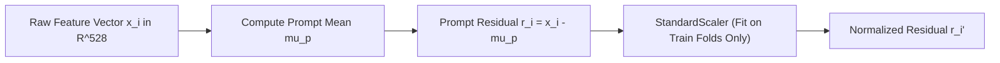

# Phase 14 / EXP_44 Representation Audit Report

**Audit Date**: November 2026  
**Audited Architecture**: EXP_40 Prompt-Residual Graph Attention Network  
**Current Input Vector**: $x_i \in \mathbb{R}^{528}$  

---

## 1. Existing Representation Breakdown

The current relational GAT in `EXP_40` operates on a 528-dimensional multi-modal feature vector:

```
┌───────────────────────────────────────────────┬───────────────────────────────────┐
│          384d MiniLM-L3 Syntactic             │        144d Stylometric           │
│   (sentence-transformers/all-MiniLM-L6-v2)    │    (Surface Stylometry Engine)    │
│                 [0 : 384]                     │            [384 : 528]            │
└───────────────────────────────────────────────┴───────────────────────────────────┘
```

### Component Details:
1. **MiniLM-L3 Syntactic Vector ($384\text{d}$)**:
   - **Model**: `sentence-transformers/all-MiniLM-L6-v2` (6 Transformer layers, hidden size $d=384$).
   - **Layer**: Layer 3 intermediate hidden state ($h_3$). Intermediate layers capture syntactic and grammatical structure rather than deep semantic topicality, making Layer 3 ideal for prompt-residual attribution.
   - **Pooling**: Masked mean pooling across valid token representations:
     $$\bar{h}_3 = \frac{\sum_{t=1}^T m_t \cdot h_{3,t}}{\sum_{t=1}^T m_t}, \quad m_t \in \{0, 1\}$$
   - **Tokenization**: Max sequence length 512 tokens with right-padding.

2. **Stylometric Vector ($144\text{d}$)**:
   - **Source**: `outputs/features_reference_stylometry.npy` (extracted via `notebooks/28_reference_stylometry.py`).
   - **Features**: Sentence lengths, character-to-token ratios, punctuation distributions (commas, semicolons, em-dashes, exclamation marks), markdown element frequencies (headers, code fences, list bullets), vocabulary diversity (type-token ratio), capitalization statistics, and readability scores.

---

## 2. Preprocessing & Prompt-Centering Pipeline

To decouple LLM identity from the specific topic requested by the prompt, the representation undergoes prompt centering strictly within each validation fold:



### Leakage Controls:
- **Training Set**: $\mu_p$ is computed using the ground-truth `prompt_id` group.
- **Validation Set**: In leak-free blind evaluation, $\mu_{\hat{p}}$ is computed using clusters recovered purely from response text via unsupervised agglomerative clustering (`recover_prompt_clusters(val_texts)`).
- **Scaler**: `StandardScaler` is fitted strictly on $R_{\text{train}}$ and applied to $R_{\text{val}}$ via `.transform()`.

---

## 3. GAT Architecture & Graph Construction

### Graph Construction:
- **Nodes**: Responses $i \in \{1, \dots, K\}$ belonging to the same prompt group ($K \le 18$).
- **Edges**: Complete intra-prompt subgraph (all responses within prompt $p$ attend to one another); zero inter-prompt edges.
- **Batch Packing**: Tensors shaped as $(B, K_{\text{max}}, D)$ with boolean mask $(B, 1, K_{\text{max}}, K_{\text{max}})$.

### Network Topology:
```
Input: r_i' in R^528
   │
   ▼
[Linear(528 -> 128) + LayerNorm + GELU + Dropout(0.2)]
   │
   ▼
[GAT Layer 1: Multi-Head Scaled Dot-Product Attention (4 heads, d_k=32)]
 + Skip Connection + LayerNorm + FFN(128 -> 256 -> 128) + LayerNorm
   │
   ▼
[GAT Layer 2: Multi-Head Scaled Dot-Product Attention (4 heads, d_k=32)]
 + Skip Connection + LayerNorm + FFN(128 -> 256 -> 128) + LayerNorm
   │
   ▼
[Classifier Head: Linear(128 -> 128) + GELU + Dropout(0.2) + Linear(128 -> 18)]
   │
   ▼
Logits in R^18 -> Softmax
```

### Training Configuration:
- Optimizer: AdamW($\text{lr}=10^{-3}$, $\text{weight\_decay}=10^{-4}$)
- Scheduler: CosineAnnealingLR($T_{\text{max}}=40$, $\eta_{\text{min}}=10^{-5}$)
- Epochs: 40
- Compute: PyTorch 2.15, GPU batched matrix operations.
