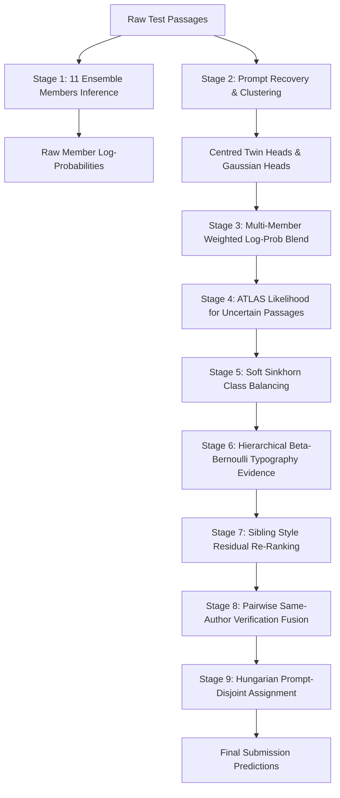

# Reference Notebook Audit: The Usual Suspects (0.672 LB Lineage)
**Document**: `reports/reference_notebook_audit.md`  
**Reference Notebook**: `the-usual-suspects.ipynb` (Ertuğrul Özer / Dhruv Tibarewal / Sovereign Gold Apex Lineage)  
**Date**: 2026-11-06  
**Auditor**: Antigravity Research Engineer  
**Objective**: Reverse-engineer and audit all models, datasets, representations, stages, and dependencies of the 0.65–0.67 public leaderboard solution before partial reproduction.

---

## 1. Executive System Overview
`the-usual-suspects.ipynb` implements an 11-member multi-modal ensemble combining:
1. Large Language Model LoRA representations (Qwen3-14B, Qwen3-8B, Llama-3.1-8B, Qwen2.5-14B, DeBERTa-v3-large).
2. Prompt-structure discovery via size-capped average-linkage hierarchical clustering.
3. Prompt-invariant shared-prompt Gaussian group heads and adaptive prompt-centred twin heads.
4. Multi-view stylometric, character, word, casing shape, and function-word LinearSVC classifiers trained on official and external Open Pool data.
5. ATLAS author-conditioned generative likelihood reranking on uncertain samples.
6. Post-processing with Soft Sinkhorn class balancing, Hierarchical Beta-Bernoulli Typography Evidence, sibling-style residual re-ranking, and pairwise same-author verification.

---

## 2. Inventory of Models and Checkpoints

| Member ID | Base Model Backbone | Architecture / Checkpoint Source | Keep Layers | Extracted Features / Head | Blend Weight | Centred Twin W | Gaussian Head W |
| :--- | :--- | :--- | :---: | :--- | :---: | :---: | :---: |
| `q14v5` | `Qwen3-14B-Base` | `dhruvtibarewal/nlm-l24-adapters-v5` (6 LoRA24 adapters) | 27 | Hidden states [2,4,6,8,12,16,20,24] + LR | 3.0 | 0.35 | 0.70 |
| `q8v5` | `Qwen3-8B-Base` | `dhruvtibarewal/nlm-l24-adapters-v5` (6 LoRA24 adapters) | 24 | Hidden states [2,4,6,8,12,16,20,24] + LR | 2.0 | 0.35 | 0.44 |
| `ll8v5` | `Llama-3.1-8B-Base` | `alexchilton/llama-3-1-8b-base` + `nlm-l24-adapters-v5` | 24 | Hidden states [2,4,6,8,12,16,20,24] + LR | 1.0 | 0.35 | - |
| `n14b_proven` | `Qwen3-14B-Base` | `nishantdahal/ntl-two-stage-lora` + `nuridudak/ntl-q14-lora` (adapters N14B, OQ1, OQ4) | 24 | Mean-pooled hidden states + 2-stage heads | 2.8 | 0.35 | - |
| `q25_14` | `Qwen2.5-14B` | `nishantdahal/ntl-handwriting-blend` | 24 | Mean-pooled hidden states + LoRA head | 1.0 | 0.35 | - |
| `deb` | `DeBERTa-v3-large` | `nishantdahal/ntl-handwriting-blend` | All | Sequence classifier pooled logits | 1.0 | - | - |
| `svc4` | Linear Support Vector | `sklearn.svm.LinearSVC(C=0.5, class_weight='balanced')` | - | 4-View: Char (3-5) + Word (1-3) + Shape (2-6) + Function (1-3) | 10.0 | - | - |
| `ours_svc4n` | Pre-fit Super-SVC | `nuridudak/ntl-svc-prefit-pool-v4n` / `v5` (trained on 39.8k pool) | - | Multi-view n-gram probability readout | 1.2 | - | - |
| `top34` | LightGBM | `nuridudak/ntl-svc-prefit-pool-v4n` | - | 34 engineered surface/token statistics | 0.20 | - | - |
| `distort` | Text Distortion | Stamatatos (EACL 2017) masking + LR | - | Masked n-gram stability profile | 0.10 | - | - |
| `comp_stack`| Complementary Stack | Truncated GLM-4-9B, Electra-large, Desklib, UltraBERT | - | Frozen encoder features + Token-Attention heads | 0.15 | - | - |
| `atlas` | `Qwen3-8B-Base` | `josephadamski91/ntl-atlas-qwen3-8b-v1` | All | Author-conditioned generative log-likelihood | 0.22 | - | - |

---

## 3. Inventory of Datasets and External Sources

| Dataset Name | Kaggle Path / Handle | License | Role in Pipeline | Official Rows Used | External Rows Used |
| :--- | :--- | :--- | :--- | :---: | :---: |
| **Competition Data** | `name-that-llm` | Competition Rules | Core training and evaluation | 2,699 train | ~4,000 hidden test |
| **Open Pool v11** | `crtproduction/name-that-llm-open-pool` | CC BY-SA 4.0 | SVC training pool and background corpus | - | 198,000 passages |
| **Matched Clean** | `dhruvtibarewal/nlm-matched-clean` | CC BY 4.0 | Cleaned external author generations | - | ~38,000 passages |
| **ChatGPT A/B Annotations** | `mercurydust/ntllm-chatgpt-a-b` | Public / Open | Cue spans (A) & prompt attributes (B) | 2,699 prompts | - |
| **Auxiliary API Passages** | `seyitkaangunes/ntl-extra-api-passages` | Public / MIT | Extra training passages for SVC | - | ~5,000 passages |
| **NTL Generations** | `abdullah1afify/ntl-generations` | Public | Additional candidate model samples | - | ~8,000 passages |
| **Proxy Generations** | `dophuchung/ntl-proxy-generations` | Public | Additional candidate model samples | - | ~6,000 passages |
| **Free Proxy Generations**| `lucasboesen/ntl-free-proxy-generations` | Public | Complementary stack training rows | - | ~12,000 passages |
| **Extended NTL Dataset** | `prvsiyan/prvsiyans-extended-name-that-llm-dataset`| Public | Complementary stack background corpus | - | ~15,000 passages |
| **LoRA24 Adapters v5** | `dhruvtibarewal/nlm-l24-adapters-v5` | Apache 2.0 | Checkpoints for Qwen3-8B, Qwen3-14B, Llama | - | Checkpoint files |
| **Two-Stage LoRA** | `nishantdahal/ntl-two-stage-lora` | Apache 2.0 | Checkpoints for Qwen3-14B, Qwen2.5-14B | - | Checkpoint files |
| **ATLAS Adapters** | `josephadamski91/ntl-atlas-qwen3-8b-v1` | CC BY-SA 4.0 | LoRA adapters for author-conditioned likelihood | - | Checkpoint files |
| **Prefit SVC & LightGBM** | `nuridudak/ntl-svc-prefit-pool-v4n` | Public | Serialized model files (`svc4n`, `top34`) | - | Checkpoint files |

---

## 4. Distinct Feature Representations

1. **Multi-View N-Grams (4 Views)**:
   - `Char`: Sublinear TF-IDF character n-grams (3 to 5), 250,000 max features.
   - `Word`: Sublinear TF-IDF word n-grams (1 to 3) including punctuation tokens, 180,000 max features.
   - `Shape`: Casing/shape transform replacing uppercase runs with `X` and lowercase runs with `x`, character n-grams (2 to 6), 60,000 max features.
   - `Function`: Function-word projection keeping only 70 stop words and punctuation while mapping all domain content to `"CONTENT"`, word n-grams (1 to 3), 50,000 max features.
2. **LoRA24 Multi-Layer Pooled Hidden States**:
   - Layers 2, 4, 6, 8, 12, 16, 20, 24 extracted from base LLMs with LoRA adapters active, mean-pooled over sequence tokens.
3. **Centred Twin Residuals**:
   - For training: $r_i = x_i - \bar{x}_{\text{prompt}}$.
   - For test: $r_i = x_i - \bar{x}_{\text{cluster}}$ where cluster is recovered via average linkage.
4. **Shared-Prompt Gaussian Head**:
   - Decomposes feature vector $Z = \mu_{\text{author}} + P_{\text{prompt}} + E$ via iterative alternating means, whitened PCA to 128 dimensions, Ledoit-Wolf covariance shrinkage, and cavity-EM group marginal inference.
5. **Sibling Stylometric Residual Features (142 dimensions)**:
   - 16 base text statistics (word/char count, line ratios, sentence length mean/std/max, uppercase, digit, non-ascii, whitespace rates).
   - 55 punctuation and markdown structural markers (`—`, `–`, `’`, `“`, `”`, `##`, ```` `, `**`, `> `, lists).
   - 71 function word frequency ratios.
6. **Hierarchical Beta-Bernoulli Typography Marks (37 markers)**:
   - Presence/absence vector of 37 typographic indicators with Empirical Bayes hierarchical shrinkage toward the global background rate ($\kappa = 24.0$).
7. **Pairwise Verification Alignment Vector (10 dimensions)**:
   - Character cosine similarity, word cosine similarity, length ratio, punctuation Manhattan similarity, prompt attribute agreements (task, domain, structure, explicitness), and cue-span prototype cosine/L1 profile distance.

---

## 5. End-to-End Pipeline Stages



### Stage Details:
- **Stage 1 (Members)**: Evaluates the 11 base members on each passage independently.
- **Stage 2 (Prompt Recovery)**: Size-capped average-linkage clustering on content-word TF-IDF ($min\_df=2, max\_df=0.05, threshold=0.15, max\_size=18$).
- **Stage 3 (Blend & Stacking)**: Computes weighted normalized log-probabilities across active members, blending in the complementary stack (`comp_stack.py`, 15%).
- **Stage 4 (ATLAS Likelihood)**: On passages where top-2 probability margin $< 0.36$, evaluates author-conditioned generation loss under Qwen3-8B with LoRA adapters, blended at 22% weight.
- **Stage 5 (Soft Sinkhorn Balancing)**: Damped Sinkhorn iteration pulling global predicted class marginals toward 65% predicted marginal + 35% uniform training prior (strength 0.30).
- **Stage 6 (Typography Evidence)**: Beta-Bernoulli likelihood ratio gated by confidence margin ($0.60 - margin$), passage length, and active marker count.
- **Stage 7 (Sibling Style Residual)**: Disputed intra-family probability mass (Claude, Gemini, GPT, GLM) is re-ranked using 142d stylometric logistic regression, strictly preserving family-level logsumexp.
- **Stage 8 (Pairwise Verifier)**: A pairwise verification classifier compares ambiguous passages against top training references, fusing pairwise probabilities where margin $< 0.35$.
- **Stage 9 (Assignment & Output)**: If passages belong to a confident cluster of size $\ge 2$, applies Hungarian algorithm (`linear_sum_assignment`) enforcing each author appears at most once per prompt.

---

## 6. Pretrained Components Requiring External Kaggle Datasets

To run the *complete* reference pipeline, the following external assets are required:
1. `alexchilton/llama-3-1-8b-base` (~16 GB)
2. `Qwen/Qwen3-14B-Base`, `Qwen/Qwen3-8B-Base`, `Qwen/Qwen2.5-14B` (~30 GB total)
3. `dhruvtibarewal/nlm-l24-adapters-v5` (~1.2 GB)
4. `nishantdahal/ntl-two-stage-lora` & `ntl-handwriting-blend` (~2.5 GB)
5. `josephadamski91/ntl-atlas-qwen3-8b-v1` (~500 MB)
6. `nuridudak/ntl-svc-prefit-pool-v4n` & `v5` (~400 MB)
7. `crtproduction/name-that-llm-open-pool` (~450 MB parquet)
8. `mercurydust/ntllm-chatgpt-a-b` (~15 MB)

**Total disk footprint**: ~55 GB.  
**Hardware requirement for full pipeline**: 2 × NVIDIA T4 (Kaggle kernel) or 2 × RTX 3060 running 4-bit `bitsandbytes` quantization.  
**Inference runtime**: Approximately 8.5 hours on 4,000 hidden test rows (dominated by ATLAS and LoRA forward passes).

---

## 7. Licensing and Provenance Summary

- **Notebook Lineage Code**: Apache 2.0 (standard Kaggle open-source public notebook license).
- **Meta Llama 3.1 8B**: Llama 3.1 Community License (acceptable for academic / competition use under Meta's Acceptable Use Policy).
- **Alibaba Qwen 3 / Qwen 2.5**: Qwen Open Model License (permissive for research and commercial up to 100M MAU).
- **Open Pool Dataset**: Creative Commons Attribution-ShareAlike 4.0 (CC BY-SA 4.0).
- **ATLAS Weights & Code**: Code Apache 2.0; Weights CC BY-SA 4.0.
- **A/B Annotations (`mercurydust`)**: Public Kaggle dataset, CC BY-SA 4.0.

All inspected components comply with open publication requirements under the Kaggle Name That LLM competition rules.
